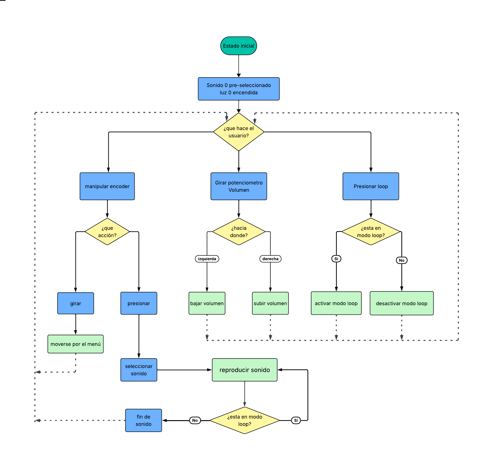

# 50N1D0

## Integrantes

[Bianka Vilchez](https://github.com/biankavilchez)

[Dayana Pañitrur](https://github.com/dayanapanitrur)

[Camila Ramirez](https://github.com/Estrabismx)

<br>

## Licencia


Este código es obra de Bianka Vilchez, Camila Ramirez y Dayana Pañitrur (2026).
Se distribuye bajo la licencia [Creative Commons Atribución-CompartirIgual 4.0 Internacional](http://creativecommons.org/licenses/by-sa/4.0/).

<br>

## Concepto

Se plantea que el sonido de un computador está condicionado por la tecnología de su época, desde los chips de síntesis que generaban melodías y efectos electrónicos hasta la incorporación de audio digital y música grabada.

A partir de esta exploración, surge la pregunta: ¿cómo ha evolucionado el sonido de los videojuegos a medida que cambian las capacidades tecnológicas de los computadores? El proyecto busca reconocer estas transformaciones y comprender cómo las características sonoras permiten identificar distintas etapas.

La evolución del sonido y la música en los videojuegos japoneses ha transitado desde los simples tonos monofónicos de los arcades y consolas de 8 bits hasta complejas bandas sonoras dinámicas e integradas con tecnología binaural y orquestal.

Fases de la evolución del sonido en Japón

Era de 8 bits y 16 bits (Años 80 - Principios de los 90): Limitada por chips de sonido de canales reducidos (como el chip PSG o el chip de FM de Yamaha en sistemas como la NES, MSX o Mega Drive/Genesis). Compositores como Koji Kondo (en Super Mario o The Legend of Zelda) y Nobuo Uematsu (en Final Fantasy) crearon melodías altamente pegajosas que definieron la identidad del chip chiptune debido a las restricciones técnicas de la memoria.

Era del CD-ROM y 32 bits (Mediados de los 90): Con la llegada de soportes como la PlayStation o la Sega Saturn, se dio el salto al audio grabado (pistas en formato Red Book CD o MIDI avanzado), permitiendo incorporar instrumentos acústicos reales, coros y arreglos orquestales más emotivos.

Era moderna y el sonido interactivo (Siglo XXI - Presente): La música y los efectos dejaron de ser simples archivos lineales para volverse adaptativos y dinámicos, reaccionando en tiempo real a las acciones del jugador, la exploración o el combate. Además, géneros como el jazz, la música electrónica y fusiones culturales pasaron a ser sellos distintivos en sagas como Persona o Sonic the Hedgehog


## Inspiración

Sharp X68000

El proyecto consiste en un dispositivo sonoro inspirado en las configuraciones y el sistema del computador Sharp X68000. La interacción se realizará mediante dos botones y dos perillas, cada uno con una función específica para seleccionar, reproducir y controlar los sonidos.

Otro aspecto interesante reside en las opciones de personalización. Sharp X68000 se puede ampliar gracias a sus puertos, permitiendo añadir cosas como un sintetizador MIDI Roland MT32 para mejorar las melodías del chip Yamaha YM2151 que trae de serie


https://www.youtube.com/channel/UC202eItEazdvnMRK09RTtaw

<br>

## ¿por qué 5 sonidos? 

- Un tono simple.
- Una secuencia rítmica.
- Una melodía sintetizada.
- Un sonido percusivo.
- Una muestra de audio digital.

La elección de cinco sonidos responde a la intención de representar distintas transformaciones tecnológicas en la historia del audio de los videojuegos. Cada sonido corresponde a una etapa que permite reconocer cómo evolucionaron la generación, síntesis y reproducción del sonido, desde los primeros tonos electrónicos hasta el audio digital. 


## Controles e interacciones

El encoder rotatorio cumple dos funciones en un solo componente: funciona como **perilla** al girarlo y como **botón** al presionarlo, ya que incluye un pulsador integrado en su eje.

| Control | Componente | Especificación | Acción |
| --- | --- | --- | --- |
| Encoder (perilla): giro horario | Encoder rotatorio con pulsador | Tipo KY-040 | Avanza al siguiente sonido. |
| Encoder (perilla): giro antihorario | Encoder rotatorio con pulsador | Tipo KY-040 | Retrocede al sonido anterior. |
| Encoder (botón): pulsación | Encoder rotatorio con pulsador | Tipo KY-040 o similar* | Reproduce el sonido seleccionado. |
| Potenciómetro (perilla) | Potenciómetro | Tipo B o lineal| Regula el volumen general en un rango de 0 a 100. |
| Botón Loop: primera pulsación | Botón pulsador | Momentáneo, 12 × 12 mm | Activa la repetición continua del sonido. |
| Botón Loop: segunda pulsación | Botón pulsador | Momentáneo, 12 × 12 mm + resistencia pull down | Desactiva la repetición continua del sonido. |
| Cinco lucecitas LED | 5 LED + 5 resistencias | LED 5 mm*, resistencias 220–330 Ω* | Indican cuál de los cinco sonidos está seleccionado. |
| Unidad de control | Microcontrolador | Raspberry Pi Pico 2 W (chip RP2350, 150 MHz, 520 KB RAM, 4 MB flash) | Lee el encoder, el potenciómetro y el botón Loop, enciende los LEDs y envía el audio al amplificador por I2S. |

### Diagrama de experiencia de usuario



<br>

## Experiencia de uso

1. **Encender el dispositivo:** el sistema se inicia y queda preparado para seleccionar un sonido.
2. **Seleccionar un sonido:** la persona gira el encoder en sentido horario o antihorario para recorrer los cinco sonidos. La lucecita correspondiente indica cuál está seleccionado.
3. **Reproducir el sonido:** la persona presiona el encoder para escuchar el sonido seleccionado.
4. **Regular el volumen:** gira el potenciómetro para ajustar el volumen general del dispositivo, dentro de un rango de 0 a 100.
5. **Activar el loop:** presiona el botón LOOP una vez para que el sonido se repita continuamente.
6. **Desactivar el loop:** presiona nuevamente el botón LOOP para desactivar la repetición.
7. **Cambiar de sonido:** gira el encoder para seleccionar otro sonido y presiónalo para reproducirlo. Si el sonido anterior estaba en loop, el sistema debe gestionar el cambio según la lógica definida para la reproducción.
8. **Explorar los cinco sonidos:** la persona puede recorrer el menú de forma continua. Después del quinto sonido, el encoder vuelve al primero; en sentido contrario, desde el primero pasa al quinto.

<br>

## Casos no deseados

Nos plantemos diversas situaciones hipoteticas y ver como debería reaccionar la máquina a ellas

Todas comienzan con la pregunta ¿que pasa si...

- ... estoy apretando botón loop y botón de selector a la vez?

    - En caso de que se presionen ambos botones en el mismo ms, se priorizará el modo loop y luego el selector

- ... mientras está sonando un audio se vuelve a presionar el botón para reproducir sonido?

    - El sonido debe parar y volver a reproducirse, esto con un margen de 500ms para no saturar la memoria en caso de que se presione de manera muy reiterativa, esto debe funcionar en base a un atributo denominado margenSonido

- ... el encoder gira mientras está sonando el audio? ¿cambian ambos o no cambia ninguno?

    - El cambio de led y sonido debe ocurrir solo si no hay sonido en reproducción

- ... el sonido queda reproduciendo en loop, luego se apaga el sistema y se enciende de nuevo, el sonido queda sonando en loop o se reincia?

    - al apagarse la máquina, debe volver al estado base. Considerando que este apagado solo posee la función de que nada pueda sonar ni encenderse, pero la raspi seguira alimentada

- ... se mantiene presionado el botón de selección mientras se gira la perillaEncoder?

    - por la lógica de class BotonGrupo1, el mantener presionado no debería afectar el selector, ya que cuenta solo la primera vez que se presiona

- ... el loop se presiona dos veces dentro de un lapso de tiempo muy corto? ¿se desactiva o se mantiene?

   - el botón loop debe funcionar en base a estadoPresionarSwitch, por lo que si es false está apagado el loop. Además este metodo debe leer un solo presionar, el mantenerlo presionado x cantidad de segundos no influye

- ... presiono loop mientras está sonando algo? ¿empezará de cero o el sonido quedará en bucle?

    - es ideal que el sonido, una vez termine se actualice al modo loop y empiece su bucle. En otras palabras, no queremos que se pare y empiece denuevo el sonido

- ... movemos la perilla de volumen mientras está sonando? ¿registra el último valor de volumen para cuando termine el sonido actual y comience otro? ¿o el volumen es regulable mientras suena?

    - Si es posible que el volumen cambie de manera dínamica mientras suena, es ideal, en caso de que no sea posible. El cambio debe ocurrir al finalizar el sonido

- ... es que mientras suena sonidoInicio.h selecciono otro audio para que se reproduzca?

    - no debe ser posible hacer nada mientras suena SonidoInicio, al igual que con sonidoLoop y sonidoApagado

- ¿ se pueden hacer sonar dos audios al mismo tiempo?

    - no debe ser posible ejecutar 2 sonidos en simultáneo

<br>

## Archivos

main.cpp

Boton.h + Boton.cpp

Perilla.h + Perilla.cpp

Sonido.h + Sonido.cpp

Lucecita.h + Lucecita.cpp

ampli.h + ampli.cpp

<br>

## seudo-código

1. Inicia la máquina

2. suena sonidoPrendido.h

3. se define los parametros inciales de la máquina, es decir, que se enciende led 0 y sonido 0 queda pre-seleccionado

4. lectura inicial de volumen [potenciometro en GPIO XX]

5. si presiona botonLoop y se habilita el modo loop 

- se identifica reproduciendo el sonidoLoopActivado.h y cambiando el led encendido a parpadear

- al momento de seleccionar uno de los 5 sónidos, este se reproducira en un bucle que acabará solo si es presionado el botonLoop nuevamente 

6. Si se gira la perillaEncoder se podrá seleccionar uno de los 5 sonidos que estan asociados al igual que los leds con valores de 0 a 4, al llegar a un extremo se mueve al otro extremo como un circulo

- todas las instancias de lucesita y sonido estan relacionadas directamente, es decir que led 0 y sonido 0 estan vinculados

7. Si se presiona botónSelector se reproduce el sonido en el que se encuentre 

8. si se gira la perillaVolumen, el valor asociado cambiará el volumen

### relación interfaz y código

- botonSelector corresponde al botón de la perilla y funciona con `leer()` y detectar `presionado`

- perillaSelector corresponde al encoder que se desplaza por los 5 sonidos seleccionables

- botonLoop es un pushbutton que está enlazado con la variable `bool estadoPresionarSwitch`, si este es falso, el estado loop es falso

- volumen es un potenciometro, ubicado en el GPIO26 y funciona con valores de 0 a 100

<br>

## clases

### class Boton

Como grupo nos corresponde realizar la clase Boton, el cuál debe funcionar tanto para lo que hagamos nosotras en nuestro proyecto, como para lo que haga el grupo 07 para el suyo.

#### Boton.h

En el archivo .h definimos todo, declaramos todo, prometemos las cosas que hará el botón, el cómo lo hará lo escribiremos en el archivo .cpp

El nombre de nuestra clases es **BotonGrupo1** 

Algo importante que debemos integrar en nuestro archivo.h son:

- La biblioteca de la Rapberry Pi Pico para poder programarla
- Biblioteca del GPIO, para integrar la conexión física de los pines de la Raspi

Hacer el código `public` hará que cualquier persona pueda ver, usar o modificar nuestra clase Boton

`int nuevoPin` Le indica a la clase en qué pin de la Raspberry Pi Pico está conectado ese botón

modoSwitch

| anterior | actual | resultado |
| :------: | :----: | :-------: |
| 0        | 0      |  0        |
| 1        | 0      | 1         |
| 1        | 1      | 0         |
| 0        | 1      | 1         |

XOR

Una u otra, pero no ambos

Cuando el anterior **o** el actual cambien de estado, el `modoSwitch` lo hará

#### Boton.cpp

Se adjunta diversos diagramas de flujo que explican el funcionamiento de cada método de la clase

##### leer()


##### bool doblePresionado()


##### presionarSwitch()


##### modoBorrar


<br>

### class Lucecita

La clase lucecita nos va ayudar a identificar de forma visual los sonidos, es la forma grafica y amigable para que el usuario pueda identificar el sonido, o indicaciones de prendido y apagado.

Método constructor Lucecita():

-Recibir el número del pin.
-Configurar el pin como salida.
-Inicializar la luz apagada.

**Método prender():**

-Cambiar el estado de la luz a encendida.
-Activar el pin para encender la luz.

**Método apagar():**

-Cambiar el estado de la luz a apagada.
-Desactivar el pin para apagar la luz.

**Metodo parpadeo():** 
para no ocupar sleep_ms(500) agregar el Metodo parpadeo(): 


### class Audio

Esta clase ayuda a esconder la complejidad que existe al momento de seleccionar que audio/sonido va a sonar. 

Si la definimos en una frase: _"Es nuestro DJ"_

Por lo mismo utilizamos `#include Audio_n.h`

> siendo n el número del audio

#### Audios

Para lograr introducir cualquier sonido para reproducir en nuestra Raspi  


- nombrar el formato que debe tener el archivo
- como cargarlo
- como funciona

- como exportar y que web usar

[File to C style array converter](https://notisrac.github.io/FileToCArray/)

<br>

### class Ampli

Se preparó

```cpp

#ifndef AMPLI_H
#define AMPLI_H

#include "hardware/adc.h"

class Ampli {

  public:

  // --atributos--
  // a que pin se conecta el BCLK
  // Bit CLocK  
  int pinReloj;

  // a que pin se conecta LRC
  // debe ir consecutivo a reloj
  int pinLRC = pinReloj + 1 ;

  // a que pin se conecta el DIN
  // Serial Audio Data 
  int pinDatos;
  
  bool sonando = false; 

  int volumen = 50;
  int frecuencia = 11025;

 // variable que enlaza al listado de sonidos que se carguen eventualmente
 // cuenta desde 0
  int sonidoActual = -1;

 // -- constructor --
 Ampli(int pinReloj, int pinDatos);

 // --metodos--
 // realiza el proceso de reproducir audio
 // reproduce sonidoActual
 void reproducir();

 // el audio debe reproducirse de manera ciclica
 //reproduce sonidoActual
 void reproducirLoop();

 // estipula como se regula el volumen
 // utiliza valores de 0 a 100
 void controlVolumen(); 
};

#endif

```

<br>

```cpp

#include "Ampli.h"

//constructor 
Ampli::Ampli(int pinReloj, int pinDatos) {

  pinReloj = nuevoPinReloj;
  pinDatos = nuevoPinDatos;

   // inicia el ampli MAX98357A pero sin reproducir ningún sonido 
   //
}

// Inicia la reproducción de audio
// esta funciona con la variable sonidoActual
// tiene inicio y fin 
void Ampli::reproducir(){
}

// A diferencia de reproducir()
// Inicia el sonido de modo ciclico
// funciona con la variable sonidoActual
void Ampli::reproducirLoop(){ 
}

// Define como se controla el volumen
// se trabaja con valores de 0 a 100
void Ampli::controlVolumen(){

}

```

<br>

## comentarios claude

Desde acá en adelante se describen distintas conversación en las que se le solicita a Claude que observe y analice nuestro código.

### revisión #1

**Prompt:**

> Revisa la versión del código v01 de grupo1 en proyecto 02. En este debes revisar y considerar que no hayan errores de sintaxis, funciones / metodos que se bloqueen, fallos de lógica, entre otros
>
> Es importante que no edites nada, pero revisa y se minusioso al hacerlo. Considera que estoy aprendiendo a programar, es por ello que todos los comentarios que realices sean desde la base explicando que falla, porque falla y como se debería solucionar.
> Para esto en el readme.md hay una sección llamada ## comentarios claude. Escribe el prompt y tus comentarios en la revisión #1

**Archivos revisados:** `codigos/v01/` → `main.cpp`, `Ampli.h/.cpp`, `Audio.h/.cpp`, `Lucecita.h/.cpp`, `PerillaGrupo7.h/.cpp`, `Sonido1.h` a `Sonido5.h`.
No se modificó ningún archivo de código.

#### Resumen rápido

| # | Problema | Gravedad | ¿Qué provoca? |
| --- | --- | --- | --- |
| 1 | Los nombres de los arreglos de sonido no coinciden | 🔴 No compila | Error "was not declared in this scope" |
| 2 | Faltan `BotonGrupo1.h` y `BotonGrupo1.cpp` en la carpeta v01 | 🔴 No compila | Error "No such file or directory" |
| 3 | No hay `CMakeLists.txt` ni está enlazada la librería de audio I2S | 🔴 No compila | No se puede construir el proyecto |
| 4 | Los sonidos están en formato WAV de 16/24 bits, pero el código los lee como 8 bits | 🔴 Suena mal | Ruido fuerte, sonido distorsionado y más lento |
| 5 | El sonido cargado puede no ser el que muestra el LED | 🟠 Error de lógica | Loop reproduce un sonido distinto al elegido |
| 6 | Parpadeo del LED parte "a destiempo" | 🟡 Detalle | El LED se apaga de inmediato al activar loop |
| 7 | Sonido de encendido y sonido de "loop activado" no están programados | 🟡 Falta funcionalidad | No coincide con el seudo-código |
| 8 | Detalles menores (canales DMA/PIO fijos, include sin usar, README desactualizado) | ⚪ Menor | Ordenar / prevenir problemas futuros |

**Buena noticia sobre "funciones que se bloqueen":** revisé todo el `while (true)` y **ninguna función bloquea el programa**. No hay `sleep_ms`, `take_audio_buffer(..., false)` no espera, el botón y el parpadeo usan el reloj (`to_ms_since_boot`) en vez de pausas, y el encoder se lee en cada vuelta. Esa parte está muy bien resuelta. 👏

---

#### 1. 🔴 Los nombres de los arreglos de sonido no coinciden (no compila)

**Dónde:** [Audio.cpp](./codigos/v01/Audio.cpp) líneas 19 a 41, y la línea 2 de cada `SonidoN.h`.

**Qué falla:** en `Audio.cpp` se usan los nombres `arreglo_sonido_1`, `arreglo_sonido_2`, ... `arreglo_sonido_5`:

```cpp
catalogo[0].muestras = arreglo_sonido_1;
catalogo[0].tamano = sizeof(arreglo_sonido_1);
```

Pero dentro de los archivos de sonido, los arreglos se llaman distinto:

```cpp
// Sonido1.h
static const uint8_t Sonido_1[]  = { ... };
```

**Por qué falla:** C++ no "adivina" nombres. Un `#include "Sonido1.h"` solo copia y pega el contenido del archivo; el nombre que existe es `Sonido_1`, no `arreglo_sonido_1`. Cuando el compilador llega a `arreglo_sonido_1` no lo encuentra y se detiene con un error tipo:

```
error: 'arreglo_sonido_1' was not declared in this scope
```

(Este error ya venía de v00, porque ahí también se usaba `arreglo_sonido_N`. El comentario de la línea 9 de `Audio.cpp` lo advierte: *"debes ajustar estos nombres para que coincidan con tus archivos reales"*.)

**Cómo solucionarlo:** que ambos lados usen el mismo nombre. Hay dos caminos, elijan **uno**:

- Cambiar `Audio.cpp` para usar `Sonido_1` ... `Sonido_5`, **o**
- Cambiar la línea 2 de cada `SonidoN.h` para que diga `arreglo_sonido_N`.

Recomendación: cambiar `Audio.cpp`, porque cada vez que vuelvan a convertir un audio con la web, el archivo nuevo traerá el nombre que ustedes escriban en la página; usen siempre el mismo patrón.

---

#### 2. 🔴 Faltan `BotonGrupo1.h` y `BotonGrupo1.cpp` en la carpeta v01 (no compila)

**Dónde:** [main.cpp](./codigos/v01/main.cpp) línea 8 → `#include "BotonGrupo1.h"`.

**Qué falla:** en la carpeta `codigos/v01/` no existe ningún archivo `BotonGrupo1.h` ni `BotonGrupo1.cpp`.

**Por qué falla:** `#include "..."` con comillas busca el archivo en la misma carpeta del `.cpp`. Si no está, el compilador se detiene con:

```
fatal error: BotonGrupo1.h: No such file or directory
```

**Ojo, hay dos versiones distintas de la clase en el repositorio:**

- `00-proyecto-2/clases/BotonGrupo1.h/.cpp` → **sí** tiene el atributo `recienPresionado` (el que usa `main.cpp` en las líneas 123 y 132).
- `grupo-01/prueba-led/BotonGrupo1.h/.cpp` → es una versión antigua, **no** tiene `recienPresionado`. Si copian esta, el error cambia a `'class BotonGrupo1' has no member named 'recienPresionado'`.

**Cómo solucionarlo:** copiar `BotonGrupo1.h` y `BotonGrupo1.cpp` desde **`00-proyecto-2/clases/`** a `codigos/v01/`.

---

#### 3. 🔴 No hay `CMakeLists.txt` ni está enlazada la librería de audio (no compila)

**Dónde:** carpeta [codigos/v01/](./codigos/v01/) completa, y [Ampli.h](./codigos/v01/Ampli.h) línea 16 → `#include "pico/audio_i2s.h"`.

**Qué falla:** la carpeta v01 solo tiene archivos `.cpp` y `.h`. Para compilar un programa de Raspberry Pi Pico se necesita un `CMakeLists.txt` (la "receta" que le dice al compilador qué archivos juntar y qué librerías usar), como el que sí tienen `prueba-led` o `prueba-multiplexor`.

Además, `pico/audio_i2s.h` **no viene en el Pico SDK normal**: pertenece a otra librería llamada **pico-extras**. Si no se agrega, aparece `fatal error: pico/audio_i2s.h: No such file or directory`.

**Por qué importa:** aunque el código esté perfecto, sin la receta no hay forma de convertirlo en el archivo `.uf2` que se carga a la Raspi.

**Cómo solucionarlo:**

1. Crear el proyecto v01 con la extensión de Raspberry Pi Pico en VS Code (igual que hicieron con `prueba-led`), placa **Pico 2 W**, y copiar dentro los archivos.
2. Descargar **pico-extras** (repositorio oficial de Raspberry Pi en GitHub) y agregar `pico_extras_import.cmake` al proyecto.
3. En el `CMakeLists.txt`, agregar todos los `.cpp` y las librerías que usa el código:

```cmake
add_executable(v01
  main.cpp
  Ampli.cpp
  Audio.cpp
  Lucecita.cpp
  PerillaGrupo7.cpp
  BotonGrupo1.cpp
)

target_link_libraries(v01
  pico_stdlib
  hardware_adc      # potenciómetro
  hardware_gpio     # leds, botones, encoder
  pico_audio_i2s    # ampli MAX98357A (viene de pico-extras)
)
```

Si falta un `.cpp` en `add_executable`, el error será del tipo `undefined reference to 'Lucecita::prender()'`: significa que el compilador vio la promesa (`.h`) pero no encontró el cómo (`.cpp`).

---

#### 4. 🔴 Los sonidos están en un formato distinto al que el código espera (suena mal)

**Dónde:** [Ampli.cpp](./codigos/v01/Ampli.cpp) líneas 165 a 171 y los archivos `Sonido1.h` ... `Sonido5.h`.

**Qué espera el código:** `actualizar()` asume que cada número del arreglo es **una muestra de 8 bits sin signo** (de 0 a 255, donde 128 es silencio):

```cpp
uint8_t muestraOriginal = datosAudio[posicionAudio];     // 1 byte = 1 muestra
int16_t muestraCentrada = (int16_t)muestraOriginal - 128; // 128 = silencio
```

**Qué tienen realmente los archivos:** si miramos los primeros bytes de cada `SonidoN.h` podemos "leer" su cabecera:

```
0x52, 0x49, 0x46, 0x46   → "RIFF"  (es un archivo .wav completo, con cabecera)
0x57, 0x41, 0x56, 0x45   → "WAVE"
...
0x11, 0x2b               → 11025 Hz  ✅ (esto sí coincide con Ampli)
0x10, 0x00               → 16 bits por muestra ❌ (Sonido2, 3, 4 y 5)
0x18, 0x00               → 24 bits por muestra ❌ (Sonido1)
```

Y al final de cada archivo aparece texto como `"Video Game Soundtrack"`: son metadatos (etiquetas) del `.wav`.

**Por qué suena mal:**

- **16 bits = 2 bytes por muestra** (24 bits = 3 bytes). El código lee de a 1 byte, entonces parte cada muestra en pedazos y los trata como muestras separadas.
- En 16 bits el silencio es `0x00 0x00` (y valores cercanos como `0xff 0xff`). Leído como 8 bits sin signo, `0x00` se convierte en −128 y `0xff` en +127: **¡el silencio se transforma en un zumbido al máximo volumen!**
- Como hay el doble (o triple) de "muestras", el sonido dura el doble (o triple) y suena más grave y lento.
- La cabecera (44 bytes al inicio) y los metadatos del final también se "reproducen", lo que agrega un clic/chasquido al comienzo y al final.

**Cómo solucionarlo (la opción más simple, sin tocar Ampli):** volver a exportar los 5 sonidos en el formato exacto que espera `Ampli`:

1. Abrir el audio en **Audacity**.
2. Pasarlo a **mono** (Pistas → Mezclar → Mezclar estéreo a mono).
3. Cambiar la frecuencia del proyecto a **11025 Hz** (abajo a la izquierda).
4. Exportar → "Otros formatos sin comprimir" → Encabezado: **RAW (header-less)** → Codificación: **Unsigned 8-bit PCM**.
5. Convertir ese archivo `.raw` con [File to C style array converter](https://notisrac.github.io/FileToCArray/), usando como nombre `Sonido_1`, `Sonido_2`... (ver punto 1) y tipo `uint8_t`.

Así, cada byte del arreglo sí es una muestra de 8 bits, sin cabecera ni metadatos, y `sizeof(...)` entrega justo la cantidad de muestras. Les recomiendo documentar estos pasos en la sección **#### Audios** del README, donde dice "nombrar el formato que debe tener el archivo".

(Otra opción sería cambiar `Ampli` para leer audio de 16 bits y saltarse la cabecera, pero es más difícil y los arreglos ocuparían el doble de memoria.)

---

#### 5. 🟠 El sonido cargado puede no ser el que muestra el LED (error de lógica)

**Dónde:** [main.cpp](./codigos/v01/main.cpp) líneas 111 a 116 y 132 a 136.

**Qué falla:** el sonido nuevo solo se carga en el ampli **en el mismo momento en que se gira el encoder**, y solo si no hay nada sonando:

```cpp
if (perillaSelector.cambio) {
  ...
  if (!amplificador.sonando) {
    audio.enviarSonido(amplificador, sonidoSeleccionado);
  }
}
```

**Paso a paso del problema:**

1. Presiono el encoder → suena el **sonido 0**.
2. Mientras suena, giro el encoder dos clics → el LED pasa al **sonido 2**, pero como `sonando` es `true`, **no se carga** el sonido 2.
3. El sonido 0 termina solo → `sonando` pasa a `false`. Nadie vuelve a revisar el encoder, porque no lo he girado de nuevo.
4. Presiono **Loop** → `alternarLoop()` llama a `reproducir()` y suena en bucle el **sonido 0**, aunque el LED que parpadea es el del **sonido 2**.

El comentario de la línea 112 dice *"así el botón Loop repite el sonido que se ve en los leds"*, pero en este caso eso no se cumple. Lo mismo pasa si giro el encoder durante un loop, lo desactivo y lo vuelvo a activar.

**Por qué falla:** la condición "cargar el sonido nuevo" depende de dos cosas que ocurren en momentos distintos (girar el encoder **y** que no esté sonando), pero el código solo la revisa en el instante en que se gira.

**Cómo solucionarlo:** sacar la carga del bloque del encoder y revisarla **en cada vuelta del while**, comparando lo que está cargado (`amplificador.sonidoActual`) con lo que se ve en los LED (`sonidoSeleccionado`). Por ejemplo, justo antes del bloque `// -- loop --`:

```cpp
// si no hay nada sonando y el sonido cargado no es el que muestra el led,
// se carga el sonido elegido para que Loop repita el correcto
if (!amplificador.sonando && amplificador.sonidoActual != sonidoSeleccionado) {
  audio.enviarSonido(amplificador, sonidoSeleccionado);
}
```

Así, apenas el sonido anterior termine, en la siguiente vuelta del while (microsegundos después) quedará cargado el sonido correcto. Esta pregunta también está en sus **Casos no deseados** (*"¿qué pasa si el encoder gira mientras está sonando el audio?"*): con este cambio la respuesta sería "el LED cambia de inmediato y el sonido nuevo queda listo cuando termine el actual".

---

#### 6. 🟡 El parpadeo del LED parte "a destiempo"

**Dónde:** [Lucecita.cpp](./codigos/v01/Lucecita.cpp) líneas 47 a 66 y [main.cpp](./codigos/v01/main.cpp) líneas 141 a 147.

**Qué pasa:** `parpadeo()` compara el tiempo actual con `ultimaLecturaParpadeo`. Ese valor parte en `0` y solo se actualiza cuando el LED parpadea. Entonces:

- La **primera vez** que se activa el loop (por ejemplo, 10 segundos después de encender), `tiempoActual - 0` es mucho mayor que 250 ms → el LED se apaga **de inmediato**, en vez de quedarse 250 ms prendido.
- Lo mismo ocurre si en modo loop se gira el encoder: el LED nuevo nunca había parpadeado (o lo hizo hace mucho) y se apaga apenas se prende.

**Por qué importa:** no rompe nada, pero se ve como un "pestañeo" raro y puede hacer pensar que el LED no prendió.

**Cómo solucionarlo:** reiniciar el "cronómetro" del parpadeo cada vez que se prende el LED a mano. Una forma simple es agregar en `Lucecita::prender()` una línea que guarde el momento:

```cpp
void Lucecita::prender() {
    prendida = true;
    gpio_put(patita, true);
    // nuevo: el parpadeo empieza a contar desde que se prendio
    ultimaLecturaParpadeo = to_ms_since_boot(get_absolute_time());
}
```

**Ojo:** `parpadeo()` también llama a `prender()`, así que esto no cambia el ritmo del parpadeo (ya guarda el mismo tiempo en la línea 65), solo arregla el primer ciclo.

---

#### 7. 🟡 Falta programar el sonido de encendido y el de "loop activado"

**Dónde:** comparación entre el **seudo-código** de este README y `main.cpp`.

**Qué pasa:** el seudo-código dice:

- Paso 2: *"suena sonidoPrendido.h"* al iniciar la máquina.
- Paso 5: *"se identifica reproduciendo el sonidoLoopActivado.h"* al activar el loop.

Ninguno de los dos existe en v01: no hay archivos `sonidoPrendido.h` ni `sonidoLoopActivado.h`, y `main.cpp` no los reproduce. No es un error del código, pero sí una diferencia entre lo que planificaron y lo que está programado.

**Cómo solucionarlo (cuando lo implementen):** tengan en cuenta que `Audio` hoy solo conoce 5 sonidos y que el encoder recorre `CANTIDAD_SONIDOS`. Si agregan estos sonidos "especiales" al mismo `catalogo`, el encoder también los podría seleccionar. Es mejor guardarlos aparte (por ejemplo un método `audio.reproducirEspecial(...)`) y decidir qué pasa si se presiona Loop mientras suena el sonido de "loop activado".

Relacionado: hoy, si el loop está activo y se gira el encoder, **el LED se mueve pero sigue sonando en bucle el sonido anterior** hasta que se presione el encoder. Puede ser una decisión válida, pero conviene escribirla en **Casos no deseados** para que quede como decisión de diseño y no como error.

---

#### 8. ⚪ Detalles menores

- **Canales DMA y PIO fijos** ([Ampli.cpp](./codigos/v01/Ampli.cpp) líneas 40 y 43): se usa siempre el canal DMA `0` y la máquina PIO `0`. Funciona hoy, pero si más adelante agregan algo que también los use (por ejemplo otra librería), chocarán. Los comentarios "ojo" ya lo advierten, ¡bien!
- **`#include <stdio.h>` sin usar** ([main.cpp](./codigos/v01/main.cpp) línea 2): no se usa `printf` en ningún lugar. No hace daño; es útil para depurar. Una idea: imprimir `printf("sonido %d\n", sonidoSeleccionado);` al girar el encoder para revisar en el monitor serial que todo funciona.
- **Potenciómetro "nervioso"**: la lectura analógica puede saltar entre dos valores (por ejemplo 49 ↔ 50) aunque nadie toque la perilla. Como solo se recalcula la ganancia, no se nota, pero si algún día ponen un `printf` dentro de `if (perillaVolumen.cambio)` verán muchos mensajes. Es normal.
- **README desactualizado**:
  - La sección **## Archivos** nombra `Boton.h`, `Perilla.h`, `Sonido.h`, `ampli.h`, pero los archivos reales son `BotonGrupo1`, `PerillaGrupo7`, `Audio`, `Ampli`.
  - El código de **### class Ampli** del README es la versión antigua: usa `nuevoPinReloj` y `nuevoPinDatos` sin declararlos y `int pinLRC = pinReloj + 1;` (que daría un valor basura, porque `pinReloj` aún no tiene valor). En v01 esto **ya está corregido** en `Ampli.cpp` (línea 18), así que solo falta actualizar el README.
  - El título dice **class Lucesita** y el archivo se llama **Lucecita**.
- **Lo que está bien hecho** y vale la pena mantener:
  - El `while` sin `sleep_ms` y `actualizar()` sin esperar: es la forma correcta de mantener el audio fluido.
  - `reproducirSonido()` respeta el orden *detener → cargar → reproducir*, evitando que el sonido nuevo parta a la mitad.
  - Usar `CANTIDAD_SONIDOS` en vez de escribir `5` en varios lugares.
  - El volumen logarítmico de 0 a 100 está bien calculado y no se desborda: el valor máximo es 127 × 256 = 32.512, que cabe en un `int16_t` (máximo 32.767).
  - La conexión de pines no tiene choques: LEDs 2–6, botones 12–13, encoder 14–15, ampli 18–19–20, potenciómetro 26.

**Orden sugerido para corregir:** 2 → 1 → 3 (hasta que compile) → 4 (para que suene bien) → 5 → 6 → 7.

<br>

### revisión #2

**Prompt:**

> Revisa la versión del código v02 de grupo1 en proyecto 02. En este debes revisar y considerar que no hayan errores de sintaxis, funciones / metodos que se bloqueen, fallos de lógica, entre otros
>
> Considera que aún no necesitamos el CMakeLists.txt
>
> Es importante que no edites nada, pero revisa y se minusioso al hacerlo. Considera que estoy aprendiendo a programar, es por ello que todos los comentarios que realices sean desde la base explicando que falla, porque falla y como se debería solucionar.
> Para esto en el readme.md hay una sección llamada ## comentarios claude. Escribe el prompt y tus comentarios en la revisión #2

**Archivos revisados:** `codigos/v02/` → `main.cpp`, `Ampli.h/.cpp`, `Audio.h/.cpp`, `BotonGrupo1.h/.cpp`, `Lucecita.h/.cpp`, `PerillaGrupo7.h/.cpp`, `sonido0.h` a `sonido4.h`.
También miré `script/convertir.py`, solo para entender cómo se generaron los sonidos.
No se modificó ningún archivo de código. Como pidieron, no se revisa el `CMakeLists.txt`.

**Ojo:** esta revisión se hizo **leyendo** el código, no compilándolo (sin `CMakeLists.txt` no se puede compilar). Revisé con cuidado la sintaxis, pero el compilador siempre tiene la última palabra.

#### ¿Qué pasó con lo de la revisión #1?

| # (rev. 1) | Problema | Estado en v02 | Comentario |
| --- | --- | --- | --- |
| 1 | Nombres de los arreglos de sonido | ✅ Resuelto | `Audio.cpp` usa `sonido0` ... `sonido4`, igual que dentro de cada `sonidoN.h`. |
| 2 | Faltaba `BotonGrupo1` | ✅ Resuelto | Está en la carpeta y tiene `recienPresionado`. |
| 3 | `CMakeLists.txt` y librería de audio | ⏸️ Pendiente a propósito | Cuando lo hagan, recuerden que `pico/audio_i2s.h` viene de **pico-extras**. |
| 4 | Formato de los sonidos | ✅ Resuelto | Ver detalle abajo. |
| 5 | El sonido cargado puede no ser el del LED | ❌ Sigue igual | Es el punto 1 de esta revisión. |
| 6 | Parpadeo del LED a destiempo | ❌ Sigue igual | Es el punto 4 de esta revisión. |
| 7 | Sonido de encendido y de "loop activado" | ❌ Sigue faltando | Es el punto 7 de esta revisión. |
| 8 | Detalles menores | 🟡 Parcial | Ver punto 8. |

**Sobre el formato de los sonidos (punto 4), lo comprobé así:** conté los números que hay dentro de cada arreglo y coinciden **exactamente** con lo que dice el comentario de cada archivo (11531, 21035, 14696, 9397 y 5248 muestras). Además, los arreglos ya no empiezan con `0x52, 0x49, 0x46, 0x46` ("RIFF"), o sea, **no traen la cabecera del .wav ni los metadatos**: son solo muestras de sonido. Y `Ampli::actualizar()` ahora lee de a 16 bits y los convierte con `(int16_t)`, que es justo el formato que guarda el script. ¡Muy bien resuelto! 👏

**También quedaron bien corregidos** (lo explican los comentarios de `main.cpp`, líneas 43 a 53):

- `PerillaGrupo7 perillaVolumen(26, 100);` ahora entrega los dos datos que pide el constructor.
- `PerillaGrupo7 perillaSelector(14, 15, CANTIDAD_SONIDOS);` ya no tiene los paréntesis vacíos. Con `perillaSelector()` C++ entendía que era una **función** y no un objeto (a esto se le llama *most vexing parse*, "el análisis más molesto"). Excelente que lo hayan dejado explicado.

#### ¿Hay errores de sintaxis o funciones que se bloqueen?

**Sintaxis:** no encontré errores. Revisé en particular:

- Que cada `#include` apunte a un archivo que existe en `v02/` (salvo `pico/audio_i2s.h`, que llega con pico-extras).
- Que los dos constructores de `PerillaGrupo7` no se confundan: con 2 datos se usa el del potenciómetro y con 3 el del encoder. ✅
- Que `const int CANTIDAD_SONIDOS = 5;` en `Audio.h` no cause "definición múltiple": en C++ una constante `const` en un `.h` es privada de cada archivo, así que no choca. ✅
- Que los `sonidoN.h` solo se incluyan en `Audio.cpp`. Si se incluyeran también en `main.cpp`, los 124 KB de sonido quedarían copiados dos veces en la memoria. ✅

**Bloqueos:** ninguna función bloquea el programa. ✅

- `take_audio_buffer(colaBuffers, false)`: el `false` significa "si no hay cajita libre, no esperes". Sale de inmediato.
- `BotonGrupo1::leer()` y `Lucecita::parpadeo()` usan el reloj (`to_ms_since_boot`) en vez de `sleep_ms`.
- Los únicos `for` del programa tienen un final fijo (256 muestras en `actualizar()`, 4 lecturas en el potenciómetro), así que siempre terminan.
- `adc_read()` sí "espera", pero solo unos 2 microsegundos (0,000002 s): no se nota.

#### Resumen de esta revisión

| # | Problema | Gravedad | ¿Qué provoca? |
| --- | --- | --- | --- |
| 1 | El sonido cargado puede no ser el que muestra el LED (viene de v01) | 🟠 Error de lógica | Loop reproduce un sonido distinto al elegido |
| 2 | El botón del encoder KY-040 funciona "al revés" de lo que espera `BotonGrupo1` | 🟠 Hardware / lógica | El botón selector no responde, o se activa al soltarlo |
| 3 | Defecto del chip RP2350 con resistencias pull-down (errata E9) | 🟠 Hardware | Un botón puede quedar "pegado" como presionado |
| 4 | Parpadeo del LED parte a destiempo (viene de v01) | 🟡 Detalle | El LED se apaga de inmediato al activar loop |
| 5 | Chasquido ("tic") al terminar o cortar un sonido | 🟡 Suena raro | Ruido corto al final de `sonido3` y al cambiar de sonido |
| 6 | El sentido de giro del encoder puede quedar invertido | 🟡 Revisar al probar | Horario retrocede en vez de avanzar |
| 7 | Falta el sonido de encendido y el de "loop activado" (viene de v01) | 🟡 Falta funcionalidad | No coincide con el seudo-código |
| 8 | Detalles menores | ⚪ Menor | Ordenar / prevenir problemas futuros |

---

#### 1. 🟠 El sonido cargado puede no ser el que muestra el LED (sigue igual que en v01)

**Dónde:** [main.cpp](./codigos/v02/main.cpp) líneas 102 a 117 y 132 a 136.

**Qué falla:** el código de esta parte es idéntico al de v01. El sonido nuevo solo se carga en el ampli **en la misma vuelta en que se gira el encoder**, y solo si no hay nada sonando:

```cpp
if (perillaSelector.cambio) {
  ...
  if (!amplificador.sonando) {
    audio.enviarSonido(amplificador, sonidoSeleccionado);
  }
}
```

**Paso a paso del problema:**

1. Presiono el encoder → suena el **sonido 0**.
2. Mientras suena, giro el encoder hasta el **sonido 2**. El LED 2 se prende, pero como `sonando` es `true`, el sonido 2 **no se carga**.
3. El sonido 0 termina solo y `sonando` pasa a `false`. Pero nadie vuelve a revisar, porque el `if (perillaSelector.cambio)` solo es verdadero en la vuelta exacta en que se gira.
4. Presiono **Loop** → `alternarLoop()` llama a `reproducir()`, que reproduce **lo que está cargado**: suena en bucle el **sonido 0**, mientras parpadea el LED 2.

Con v02 aparece otro camino al mismo error: con el loop activo giro al sonido 2 (sigue sonando el 0 en bucle), desactivo el loop, el 0 termina su vuelta, y si vuelvo a activar el loop... suena otra vez el 0.

**Por qué falla:** la acción "cargar el sonido nuevo" depende de dos condiciones (que se haya girado el encoder **y** que no esté sonando nada), pero esas dos cosas pueden pasar en momentos distintos. El código solo revisa ambas en el instante del giro.

**Cómo solucionarlo:** revisar la condición **en cada vuelta del while**, comparando lo que está cargado (`amplificador.sonidoActual`, que en v02 ya se actualiza en `Audio::enviarSonido()`) con lo que se ve en los LED (`sonidoSeleccionado`). Por ejemplo, justo antes del bloque `// -- loop --`:

```cpp
// si no hay nada sonando y el sonido cargado no es el que muestra el led,
// se carga el sonido elegido para que Loop repita el correcto
if (!amplificador.sonando && amplificador.sonidoActual != sonidoSeleccionado) {
  audio.enviarSonido(amplificador, sonidoSeleccionado);
}
```

Con esto, el `if (!amplificador.sonando)` de la línea 114 ya no hace falta (se puede borrar), porque este nuevo bloque cubre ese caso y también el del sonido que termina después.

---

#### 2. 🟠 El botón del encoder KY-040 funciona "al revés" de lo que espera `BotonGrupo1`

**Dónde:** [main.cpp](./codigos/v02/main.cpp) línea 28 (`BotonGrupo1 botonSelector(12);`) y [BotonGrupo1.h](./codigos/v02/BotonGrupo1.h) líneas 23 a 31.

**Qué espera la clase:** `BotonGrupo1` está hecha para una conexión **pull-down**: una pata del botón va a 3.3V, y el pin tiene una resistencia a GND. Así:

- suelto → el pin lee `0`
- presionado → el pin lee `1`

**Cómo funciona el KY-040:** si usan el **módulo** KY-040 (la placa pequeña con 5 pines: `GND`, `+`, `SW`, `DT`, `CLK`), el botón interno conecta el pin `SW` **a GND** cuando se presiona. Es decir, funciona al revés (a esto se le llama "activo en bajo"):

- presionado → `SW` queda en `0`
- suelto → `SW` queda "flotando" (o en `1` si el módulo trae resistencia pull-up)

**Por qué falla:**

- **Si conectan una pull-down a `SW`:** el pin está en `0` cuando está suelto y en `0` cuando está presionado. Nunca cambia → `recienPresionado` nunca es `true` → **no se puede reproducir ningún sonido**.
- **Si el módulo trae pull-up:** la lectura queda invertida. Apenas se enciende la Raspi, `leer()` ve un `1` (porque está suelto), lo toma como "recién presionado" y **reproduce un sonido solo**. Después, el sonido se activará **al soltar** el botón, no al presionarlo.

**Cómo solucionarlo (elijan una):**

- **Opción A (sin tocar código):** usar un encoder "suelto", sin módulo. Esos tienen las dos patas del botón separadas, y se pueden conectar igual que el botón Loop: una pata a 3.3V y la otra al GPIO 12 con resistencia pull-down a GND.
- **Opción B (agregar una opción a la clase):** como `BotonGrupo1` también la usa el grupo 07, se puede agregar un dato **opcional** al constructor, que por defecto deje todo como está. Por ejemplo:

```cpp
// BotonGrupo1.h
// invertido = true para botones que conectan a GND al presionar (como el KY-040)
// por defecto es false, asi la clase sigue funcionando igual para el grupo 07
BotonGrupo1(int nuevoPin, bool nuevoInvertido = false);
bool invertido = false;

// BotonGrupo1.cpp, en el constructor
invertido = nuevoInvertido;
gpio_init(pin);
gpio_set_dir(pin, GPIO_IN);
if (invertido) {
  // resistencia interna hacia 3.3V: suelto lee 1, presionado lee 0
  gpio_pull_up(pin);
}

// BotonGrupo1.cpp, en leer()
bool nuevoPresionado = gpio_get(pin);
if (invertido) {
  // damos vuelta la lectura para que presionado siga siendo true
  nuevoPresionado = !nuevoPresionado;
}
```

y en `main.cpp`: `BotonGrupo1 botonSelector(12, true);`. El resto de la clase (`recienPresionado`, `doblePresionado()`, etc.) sigue funcionando igual, porque todo depende de `nuevoPresionado`.

**Cómo saber cuál es su caso:** miren el encoder que compraron. Si es una plaquita con los 5 pines nombrados, es el módulo y les afecta este punto.

---

#### 3. 🟠 Defecto del chip RP2350 con resistencias pull-down (errata E9)

**Dónde:** el circuito de los dos botones (GPIO 12 y 13), y la tabla de **Controles e interacciones** del README, que dice "resistencia pull down" sin indicar el valor.

**Qué pasa:** el chip de la Pico 2 W (RP2350) tiene un defecto de fábrica conocido, que Raspberry Pi publicó en su documento de erratas (errores del chip) como **RP2350-E9**. Cuando un pin configurado como entrada recibe 3.3V y luego se suelta el botón, el pin puede quedarse "atrapado" en unos 2 V, porque por dentro se escapa un poquito de corriente. Una resistencia pull-down "débil" (de valor alto) no tiene fuerza suficiente para bajarlo a 0.

**Por qué importa:** si pasa, el pin sigue leyendo `1` aunque nadie lo esté presionando: el botón parece **pegado**. `presionado` queda en `true` para siempre y `recienPresionado` no vuelve a activarse. Por eso la Pico 2 no tiene buenos resultados con la pull-down interna (`gpio_pull_down`), y por eso está bien que la clase pida una resistencia externa.

**Cómo solucionarlo:**

- Usar una resistencia pull-down externa de **8,2 kΩ o menos** (por ejemplo 4,7 kΩ). Una de 10 kΩ, que es muy común en tutoriales, puede no bastar.
- O usar la conexión "al revés" (pull-up, botón a GND) del punto 2, opción B: esa conexión no tiene este problema.
- Escribir el valor de la resistencia en la tabla de **Controles e interacciones**, para que nadie use una de 10 kΩ por costumbre.

Les recomiendo buscar "RP2350 errata E9" en el datasheet del RP2350 (sección *Errata*) para leer el detalle oficial.

---

#### 4. 🟡 El parpadeo del LED parte a destiempo (sigue igual que en v01)

**Dónde:** [Lucecita.cpp](./codigos/v02/Lucecita.cpp) líneas 47 a 66 (es idéntico al de v01).

**Qué pasa:** `ultimaLecturaParpadeo` parte en `0` y solo se actualiza dentro de `parpadeo()`. La primera vez que se activa el loop (por ejemplo, 10 segundos después de encender), `tiempoActual - 0` ya es mucho más que 250 ms, entonces el LED **se apaga de inmediato** en vez de quedarse prendido 250 ms. Lo mismo pasa con el LED nuevo cuando se gira el encoder durante el loop.

**Cómo solucionarlo:** reiniciar el "cronómetro" del parpadeo cada vez que se prende el LED:

```cpp
void Lucecita::prender() {
    prendida = true;
    gpio_put(patita, true);
    // el parpadeo empieza a contar desde que se prendio
    ultimaLecturaParpadeo = to_ms_since_boot(get_absolute_time());
}
```

Como `parpadeo()` también llama a `prender()`, esto no cambia el ritmo del parpadeo, solo arregla el primer ciclo.

---

#### 5. 🟡 Chasquido ("tic") al terminar o cortar un sonido

**Dónde:** [sonido3.h](./codigos/v02/sonido3.h) (últimas muestras) y [Ampli.cpp](./codigos/v02/Ampli.cpp) líneas 177 a 190.

**Qué pasa:** el parlante tiene una membrana que se mueve según el número de cada muestra: `0` es "en reposo" y valores grandes la empujan hacia afuera o hacia adentro. Si de una muestra a la siguiente el número salta de golpe, la membrana da un "golpe" y se escucha un **tic**.

- `sonido3` **no termina en silencio**: sus últimas muestras valen cerca de **+450** (por ejemplo `0x01c9`, `0x01b7`). Cuando termina, `actualizar()` pasa de 450 a 0 de golpe → tic. En loop, además, salta de +450 al primer valor (cerca de −10) en cada vuelta.
- Lo mismo pasa cuando se presiona el encoder **a la mitad** de un sonido: `reproducirSonido()` lo corta en el valor que tenga en ese momento (puede ser 20.000) y salta a 0.
- Revisé también que todos los sonidos llegan al valor máximo (±32.767). Con volumen 100 puede sonar saturado en un parlante pequeño.

**Por qué importa:** no rompe nada, pero suena "sucio", sobre todo en loop.

**Cómo solucionarlo (lo más simple, sin tocar código):** en Audacity, antes de convertir:

1. **Efecto → Normalizar**, marcando "Eliminar desplazamiento DC" y con pico máximo en **−1 dB**. Eso centra el sonido en 0 y le deja un poco de margen.
2. Seleccionar los últimos ~20 ms y aplicar **Efecto → Desvanecer progresivamente** (*fade out*), y lo mismo al inicio con *fade in*. Así el sonido empieza y termina en 0.

(Para el corte a la mitad habría que agregar un "mini fade" dentro de `Ampli`. Es más avanzado y pueden dejarlo para después.)

---

#### 6. 🟡 El sentido de giro del encoder puede quedar invertido

**Dónde:** [main.cpp](./codigos/v02/main.cpp) línea 53.

**Qué pasa:** el README dice que el giro **horario avanza** al siguiente sonido. Pero qué sentido cuenta como `+1` depende de cuál cable va al GPIO 14 (CLK) y cuál al 15 (DT). El código está bien; solo hay que comprobarlo en la placa.

**Cómo solucionarlo si sale al revés:** la clase ya trae la solución (el cuarto dato, `invertir`):

```cpp
PerillaGrupo7 perillaSelector(14, 15, CANTIDAD_SONIDOS, true);
```

o intercambiar los cables de CLK y DT. Otro detalle a probar: la clase cuenta un paso cuando las dos señales vuelven a `1` (ver el comentario en [PerillaGrupo7.cpp](./codigos/v02/PerillaGrupo7.cpp) líneas 95 y 96). En el KY-040 eso coincide con cada "clic" que se siente al girar, pero si con otro encoder avanza un sonido cada 2 clics, ese es el motivo.

---

#### 7. 🟡 Falta el sonido de encendido y el de "loop activado" (sigue igual que en v01)

El seudo-código dice que al iniciar suena `sonidoPrendido.h` (paso 2) y que al activar el loop suena `sonidoLoopActivado.h` (paso 5). En v02 todavía no existen. No es un error, pero sí una diferencia con lo planificado. Recuerden lo comentado en la revisión #1: si los agregan al `catalogo`, el encoder también podría seleccionarlos, así que conviene guardarlos aparte.

---

#### 8. ⚪ Detalles menores

- **`Lucecita.h` no termina con un salto de línea** (la última línea es `#endif` sin "enter" al final). Hoy no causa error, pero algunos compiladores muestran un aviso (*warning*). Basta con poner el cursor al final de `#endif` y presionar Enter.
- **`pinLRC` se guarda pero no se usa** ([Ampli.cpp](./codigos/v02/Ampli.cpp) línea 19): la librería calcula el pin LRC sola (siempre es `clock_pin_base + 1`). No está mal tenerlo, sirve como recordatorio. Solo sepan que si lo cambian, no pasa nada.
- **Canales DMA y PIO fijos en 0** ([Ampli.cpp](./codigos/v02/Ampli.cpp) líneas 41 y 44): siguen igual que en v01. Funciona, pero si agregan otra librería que use el canal DMA 0, chocarán.
- **`volumen` se puede cambiar directo** (es `public`): si alguien escribe `amplificador.volumen = 80;` la ganancia no se recalcula. El comentario de [Ampli.h](./codigos/v02/Ampli.h) línea 44 ya lo advierte; bien.
- **Encabezado de `BotonGrupo1.h` incompleto** (líneas 3 a 5): dice `desarrollado por:` y `licencia` sin completar. Como la clase la usa otro grupo, conviene llenarlo.
- **README desactualizado** (igual que en la revisión #1): la sección **## Archivos** nombra `Boton.h`, `Perilla.h`, `Sonido.h`, `ampli.h`; el código de **### class Ampli** es la versión antigua; y el título dice **class Lucesita**. Además, ahora que tienen `script/convertir.py`, la sección **#### Audios** podría explicar los pasos: exportar el `.wav` en mono, 16 bits, 11025 Hz y correr `python convertir.py ../audio/audios-test/*.wav -o ../codigos/v02`.

**Lo que está bien hecho** y vale la pena mantener:

- Separar "modo loop" (`enLoop`, solo lo cambia `alternarLoop()`) de "está sonando" (`sonando`). Hace que la lógica sea mucho más fácil de seguir que en v00.
- `reproducirSonido()` respeta el orden *detener → cargar → reproducir*.
- El volumen sigue sin desbordarse: con ganancia 1,0 (volumen 100), la muestra más grande, 32.767 × 1,0, cabe justo en un `int16_t`.
- `cambiarVolumen()` se llama solo cuando la perilla cambió, y no en cada vuelta.
- La tabla `paso[16]` del encoder está bien armada: revisé los 16 casos, un giro completo suma exactamente +4 hacia un lado y −4 hacia el otro, y los rebotes del contacto se anulan solos (+1 y −1).
- No hay choques de pines: LEDs 2–6, botones 12–13, encoder 14–15, ampli 18–19–20, potenciómetro 26. Ninguno usa los pines 23, 24, 25 y 29, que en la Pico 2 **W** están reservados para el chip inalámbrico.

#### Bonus: cómo responde v02 a sus "Casos no deseados"

Leyendo el código, esto es lo que **hace hoy** el programa en cada caso. Si alguna respuesta no es la que quieren, es una decisión de diseño a cambiar:

| Caso | Qué hace v02 |
| --- | --- |
| Loop y reproducir presionados a la vez | Primero se reproduce el sonido elegido (desde el inicio) y luego se activa o desactiva el loop sobre ese sonido. |
| Presionar reproducir mientras suena | El sonido se corta y vuelve a empezar desde el inicio (con un posible "tic", ver punto 5). |
| Girar el encoder mientras suena | El LED cambia de inmediato; el sonido que suena sigue hasta terminar (ver punto 1). |
| Apagar y prender con loop activo | Vuelve sin loop y en el sonido 0: `enLoop` parte en `false` y nada se guarda en memoria al apagar. |
| Mantener presionado el selector y girar | El giro cambia el sonido elegido; el botón solo cuenta una vez (`recienPresionado`), al momento de presionar. |
| Loop presionado dos veces muy rápido | Si las dos pulsaciones están separadas por más de 50 ms, cuentan las dos y el loop queda como estaba. Si es menos, se toma como una sola (filtro de rebote). |
| Presionar loop mientras suena | No vuelve a empezar: el sonido que está sonando sigue, y al llegar al final se repite. |
| Mover el volumen mientras suena | Cambia en ese mismo momento, sin esperar al siguiente sonido. |
| ¿Dos sonidos al mismo tiempo? | No. `Ampli` guarda un solo `datosAudio`, así que cargar uno reemplaza al otro. |

**Orden sugerido para corregir:** 2 y 3 (antes de soldar, porque son de circuito) → 1 → 4 → 5 → 6 (al probar en la placa) → 7.
