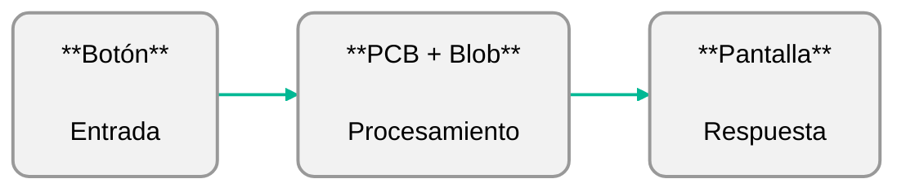
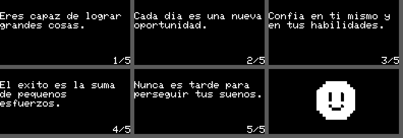
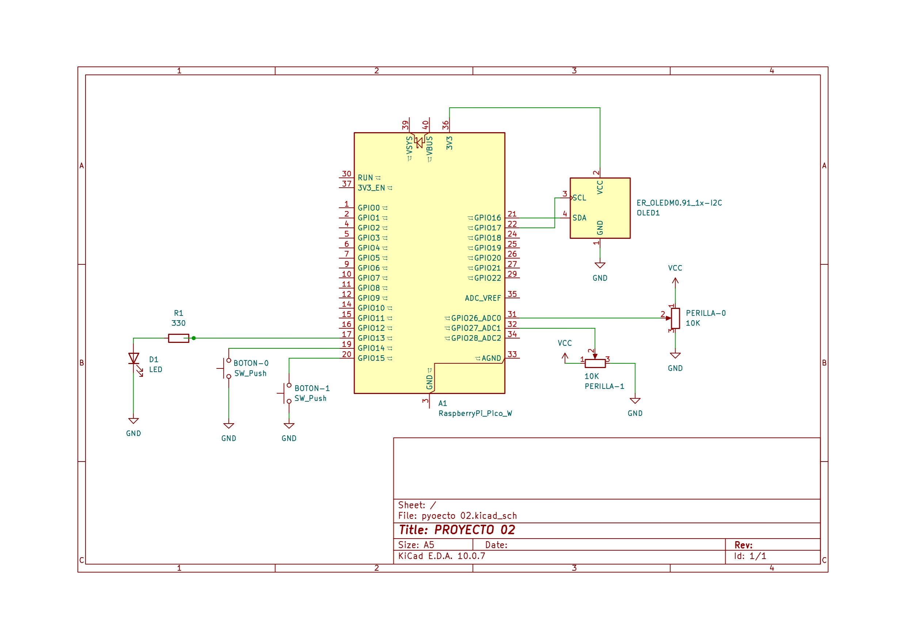
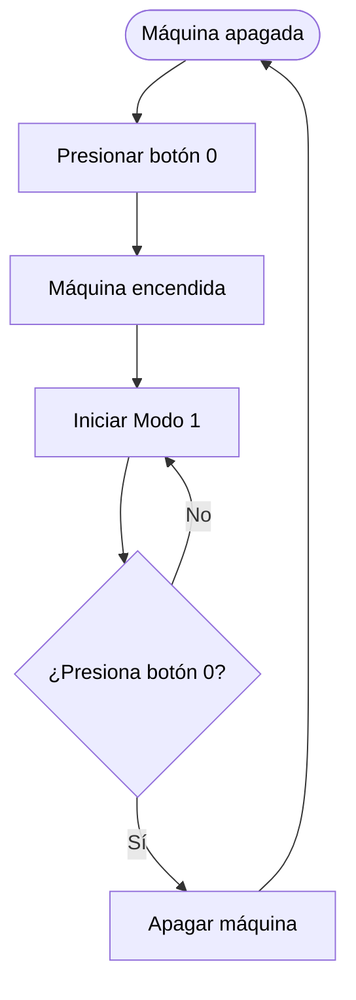
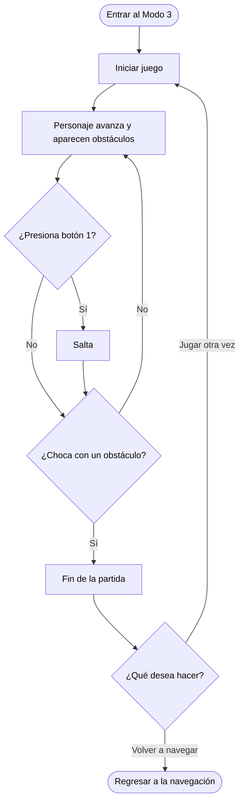
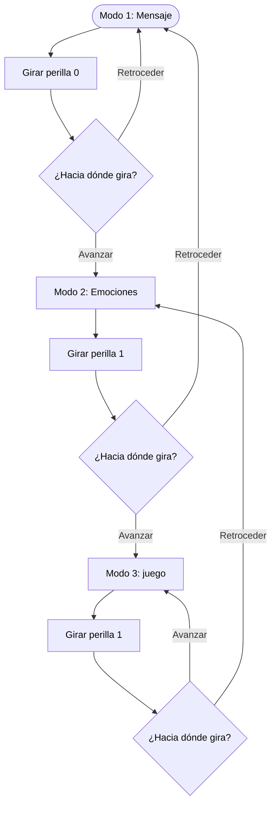
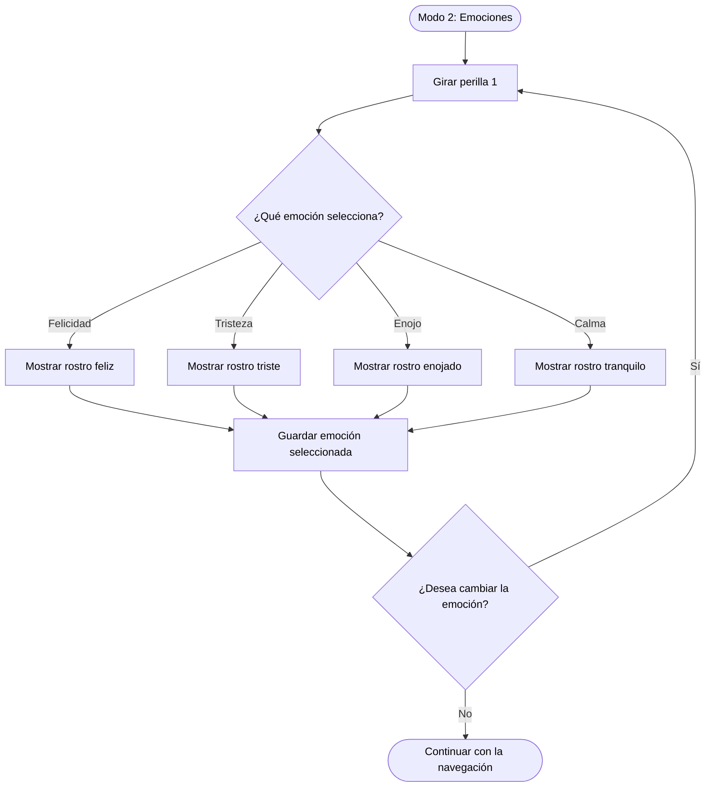

# proyecto-02

## Nombre del proyecto

**Integrantes:** 
- Magdalena Balart [_(magdalenabalart)_](https://github.com/disenoUDP/dis8645-2026-2-procesos-2/tree/main/02-magdalenabalart)
- Catalina Oyanedel [_(catalinaoyanedel-01)_](https://github.com/disenoUDP/dis8645-2026-2-procesos-2/tree/main/17-catalinaoyanedel-01)
- Yaira Ruiz [_(yairaruiz)_](https://github.com/disenoUDP/dis8645-2026-2-procesos-2/tree/main/26-yairaruiz)
- Marcela Zuñiga [_(marcezm)_](https://github.com/disenoUDP/dis8645-2026-2-procesos-2/tree/main/32-marcezm)

## Concepto
Durante la infancia, los primeros acercamientos a la tecnología muchas veces ocurrían a través de pequeñas máquinas que, con pantallas simples, botones y sonidos electrónicos, construían pequeños universos interactivos. No necesitaban grandes capacidades ni funciones complejas, si no que, bastaba con presionar un botón para descubrir algo nuevo, cambiar una expresión, recibir un mensaje o comenzar un juego.  
Estos dispositivos representaban una primera aproximación al mundo digital, donde el descubrimiento formaba parte de la experiencia y más que herramientas destinadas a resolver problemas, eran objetos que invitaban a imaginar, explorar y jugar.
A partir de esta idea, el proyecto busca recuperar esa experiencia de inmersión tecnológica sencilla buscando reinterpretar el lenguaje proponiendo un pequeño universo de interacción en torno a las emociones, donde cada acción abre una nueva posibilidad de exploración.

## Descripción general
El proyecto consiste en una máquina que tiene como fin ser un acompañamiento emocional, permitiendo explorar distintas formas de interactuar.

La máquina cuenta con tres estados de la pantalla principales:

- Modo 01 – Mensajes: presenta una serie de mensajes motivacionales que se pueden explorar.
- Modo 02 – Emociones: muestra emociones representadas con íconos de caras, las cuales pueden modificarse y elergirse.
- Modo 03 – Juego: presenta un juego en el que un personaje debe saltar obstáculos. Su nivel de dificultad cambia dependiendo de la emoción seleccionada.

### Referentes
Nuestra principal inspiración son los computadores de juguete de los años 2000, los cuales imitaban la apariencia de computadores convencionales, pero adaptaban sus funciones a una interacción más simple y accesible. Estos juguetes ofrecían experiencias de aprendizaje y entretenimiento mediante actividades predeterminadas, personajes digitales y juegos sencillos, utilizando pantallas simples y botones para ofrecer estas experiencias.

Elegimos como principal referente un Digital Desktop PC de la marca KB Learning Toys.


  
<details>
<summary> ¿Cómo funciona? </summary>
 
Este computador en su interior se define el funcionamiento a través de tres sistemas: 

**1. La placa base central (PCB) y el chip "Blob"**

- **La PCB (Printed Circuit Board)** es una placa electrónica que conecta y organiza los componentes del computador

- **Chip «Blob» (Chip-on-Board)**

Blob es esa pequeña protuberancia negra, generalmente circular, que aparece sobre algunas placas electrónicas. 

En realidad, no es el chip propiamente tal, sino una capa de resina epoxi que protege un circuito integrado montado directamente sobre la placa. Esta técnica se conoce como Chip-on-Board (COB).

  - Interpretar las pulsaciones de los botones.
  - Ejecutar los juegos o actividades programadas.
  - Controlar los gráficos de la pantalla.
  - Gestionar sonidos y respuestas del juguete.
    


**2. El sistema de pantalla (Monitor)**

- **Pantalla LCD pasiva:** La carcasa de plástico imitaba la forma de un monitor convencional, mientras que la imagen se mostraba en una pequeña pantalla LCD.
- **Cables planos (Ribbon cables)**

**3. Conectividad y Puertos**

El computador utilizaba conexiones eléctricas simples para comunicar sus controles con la placa principal (PCB). En este tipo de juguetes, el teclado podía funcionar mediante una membrana con contactos conductores que detectaban las pulsaciones, mientras que el mouse se conectaba mediante un puerto físico para transmitir señales de movimiento y clic.

Este computador nos parece un referente interesante por la manera en que transforma la tecnología en una experiencia de juego sencilla y cercana. Nos llama la atención cómo, a través de controles físicos y respuestas visuales simples, logra despertar la curiosidad e invitar a la exploración. Queremos rescatar esa forma de interactuar, donde cada acción tiene una respuesta y el usuario aprende mientras juega.

</details>

### Decisiones
A partir de este referente, destacamos sus características como pantallas LCD, los botones físicos, colores vívidos, el teclado, los gráficos de baja resolución y que cuenta con estos tres modos (word games, math games y fun games). Decidimos mantener la estructura del monitor, ocupar el recurso del teclado para tener nuestros botones y perillas separadas de la pantalla, para proponer una experiencia similar a la de este tipo de computador, y tener 3 modos de "juego", reinterpretándolo con nuestro objetivo.

### Materialidad e interfaz
Planeamos realizar la carcasa en impresión 3d, para mantenernos fiel a las formas y materiales de nuestro referente. Mientras que la interfaz, mantenemos esta estética pixelada inspirada en el diseño 

#### Boceto


#### Interfaz


#### Modelado


---

## Funcionamiento del sistema

### BOM: Lista de componentes

| **Control / Elemento** | **Componente** | **Especificación** | **Acción** |
|---|---|---|---|
| Botón de encendido/apagado | Botón pulsador | Momentáneo, conectado a GP14 | Alterna entre el estado encendido y apagado de la máquina. |
| Botón de salto | Botón pulsador | Momentáneo, conectado a GP15 | Permite ejecutar el salto del personaje durante el juego. Solo funciona en el modo 03. |
| Perilla de selección de modo | Potenciómetro | Tipo lineal, conectado a GP26. Tres rangos de selección. | Permite cambiar entre los tres modos de pantalla: Emociones, Mensajes y Juego. |
| Perilla de selección emocional | Potenciómetro | Tipo lineal, conectado a GP27. Cuatro rangos de selección. | Permite seleccionar una de las cuatro emociones disponibles. |
| Perilla de selección de mensajes | Potenciómetro | Tipo lineal, conectado a GP27. Cinco rangos de selección. | Permite navegar entre los cincos mensajes disponibles. |
| Luz indicadora | LED + resistencia 330k | LED conectado a GP13, con resistencia limitadora de corriente. | Se enciende al seleccionar el modo 03, indicando que el juego está activo. |
| Pantalla | Pantalla OLED | Controlador SSH1106, resolución 128 × 64 píxeles. | Presenta las expresiones, mensajes y elementos gráficos del juego. |
| Unidad de control | Microcontrolador | Raspberry Pi Pico 2 W, chip RP2350, 150 MHz, 520 KB RAM y 4 MB flash. | Procesa las entradas de los botones y potenciómetros, controla los modos de funcionamiento y gestiona las respuestas visuales de la pantalla y el LED. |


### Esquemático



### Diagramas de flujos
Definen la experiencia del usuario y cómo funciona cada componente.

#### Usuario:
```mermaid
flowchart TB
  ---
config:
 theme: default
---
flowchart TB
   Start(["Presionar botón 0"]) --> PowerOn["Máquina encendida"]
   PowerOn --> Screen1["Modo 1: Mensajes"]
   Screen1 --> Pot01{"Perilla 0:<br>Navegar por los modos"} & Pot11{"Perilla 1:<br>Cambiar mensajes"}
   Pot01 -- MODO 1 --> Screen1
   Pot01 -- MODO 2 --> Screen2["Modo 2: Emociones"]
   Pot01 -- MODO 3 --> Screen3["Modo 3: Juego"]
   Pot11 -- Mensaje 1 --> Message1["Eres capaz de lograr grandes cosas."]
   Pot11 -- Mensaje 2 --> Message2["Cada día es una nueva oportunidad."]
   Pot11 -- Mensaje 3 --> Message3["Confía en ti mismo y en tus habilidades."]
   Pot11 -- Mensaje 4 --> Message4["El éxito es la suma de pequeños esfuerzos."]
   Pot11 -- Mensaje 5 --> Message5["Nunca es tarde para perseguir tus sueños."]
   Screen2 --> Pot12{"Perilla 1:<br>Seleccionar emoción"}
   Pot12 -- Felicidad --> Happy["Felicidad"]
   Pot12 -- Tristeza --> Sad["Tristeza"]
   Pot12 -- Enojo --> Angry["Enojo"]
   Pot12 -- Calma --> Calm["Calma"]
   Happy --> StoreEmotion["Guardar emoción seleccionada"]
   Sad --> StoreEmotion
   Angry --> StoreEmotion
   Calm --> StoreEmotion
   StoreEmotion --> Pot01
   Screen3 --> DifficultyCheck{"¿Qué emoción<br>está almacenada?"}
   DifficultyCheck -- Calma --> CalmSpeed["Velocidad muy lenta<br>Muy pocos obstáculos"]
   DifficultyCheck -- Tristeza --> SadSpeed["Velocidad lenta<br>Pocos obstáculos"]
   DifficultyCheck -- Felicidad --> HappySpeed["Velocidad media<br>Obstáculos moderados"]
   DifficultyCheck -- Enojo --> AngrySpeed["Velocidad muy rápida<br>Obstáculos muy frecuentes"]
   CalmSpeed --> GameStart["Iniciar juego"]
   SadSpeed --> GameStart
   HappySpeed --> GameStart
   AngrySpeed --> GameStart
   GameStart --> Obstacles["Personaje avanza<br>y aparecen obstáculos"]
   Obstacles --> Jump["Botón 1: Saltar"]
   Jump --> Collision{"¿Chocó con<br>un obstáculo?"}
   Collision -- No --> Obstacles
   Collision -- Sí --> GameOver["Fin de la partida"]
   GameOver --> Replay{"¿Qué desea hacer?"}
   Replay -- Jugar otra vez --> GameStart
   Replay -- Volver al recorrido --> Pot01


   style Start color:#000000
   style PowerOn color:#000000
   style Screen1 color:#000000
   style Pot01 color:#000000
   style Pot11 color:#000000
   style Screen2 color:#000000
   style Screen3 color:#000000
   style Message1 color:#000000
   style Message2 color:#000000
   style Message3 color:#000000
   style Message4 color:#000000
   style Message5 color:#000000
   style Pot12 color:#000000
   style Happy color:#000000
   style Sad color:#000000
   style Angry color:#000000
   style Calm color:#000000
   style StoreEmotion color:#000000
   style DifficultyCheck color:#000000
   style CalmSpeed color:#000000
   style SadSpeed color:#000000
   style HappySpeed color:#000000
   style AngrySpeed color:#000000
   style GameStart color:#000000
   style Obstacles color:#000000
   style Jump color:#000000
   style Collision color:#000000
   style GameOver color:#000000
   style Replay color:#000000
```

<details>
<summary> Botón 0: en detalle </summary>


</details>

<details>
<summary> Botón 1: en detalle </summary>
  

</details>

<details>
<summary> Perilla 0: en detalle </summary>



</details>

<details>
<summary> Perilla: en detalle </summary>
  


</details>

## Estructura del código

```
codigo/
├── main.cpp
  └── Boton.h              // clases de componentes
  └── Boton.cpp
  └── Perilla.h
  └── Perilla.cpp
  └── Led.h
  └── Led.cpp
  └── Pantalla.h
  └── Pantalla.cpp
  └── Emociones.h         // clases de modos de pantalla
  └── Emociones.cpp
  └── Mensajes.h
  └── Mensajes.cpp
  └── Juego.h
  └── Juego.cpp
  └── Rostros.h          // graficas de emociones

```

### Wokwi
https://wokwi.com/projects/479334243939894273

### Clases escritas por nosotras

#### `Perilla`

Qué hace: Representa los potenciómetros físicos que en nuestro caso permiten seleccionar emociones, mensajes y navegar entre pantallas.

Atributos:
- `int patita`: identifica el pin donde esta conectada
- `int pin`: identifica la entrada análoga
- `int canal`: identifica el canal ADC pines físicos que corresponde a la patita
- `int valor`: guarda el ultimo valor analógico de la perilla entre 0 y 4095
- `int cantidadOpciones`: define cuantas opciones puede seleccionar la perilla
- `int opcionSeleccionada`: guarda la opción seleccionada según el rango del potenciómetro
- `int tipo`: identifica el tipo de perilla (la 0 o la 1)
- `bool movio`: indica si la perilla se movió
-  `int umbral`: // define el cambio mínimo para considerar que la perilla se movió
-  `bool invertir`: permite invertir el sentido de la perilla
  
Métodos:
- `int muestrear()`: realiza varias lecturas
- `int leerValor()`: obtiene y guarda el valor analógico del potenciómetro
- `int posicion(int cantidad)`: convierte el valor analógico en una posición de 0 a cantidad - 1, dividiendo el recorrido en partes iguales
- `void definirOpciones(int numeroOpciones)`: establece cuántas opciones puede seleccionar la perilla y recalcula la opción seleccionada
- `void calcularOpcion()`: convierte el valor analógico en una opción y la guarda en opcionSeleccionada
- `void leer()`: hace una nueva lectura y la compara con el valor anterior; si el cambio supera el umbral, actualiza valor y deja movio en true. Así el ruido no cambia la opción (histéresis)


Constructor:
- Recibe el pin de la perilla, recibe el tipo y cantidad de opciones, permite configurar inversion y umbral. Configura el pin como entrada analógica y hace la primera lectura.

```cpp
  Perilla(int nuevoPin, int nuevoTipo = 0,
          int nuevaCantidadOpciones = 0,
          bool nuevoInvertir = false,
          int nuevoUmbral = 30);
```

Se relaciona con: `main.cpp`, que usa una perilla para navegar entre las 3 pantallas (GP26, 3 opciones) y otra para elegir la emoción o el mensaje (GP27, 4 opciones).

------

#### `Led`

Qué hace: Controla el LED que avisa que el botón de salto está disponible.

Atributos:
- `int patita`: pin donde está conectado el LED
- `bool prendido`: indica si el LED está encendido o apagado

Métodos:
- `void prender()`: enciende el LED
- `void apagar()`: apaga el LED
- `void actualizar(int modoActual)`: enciende el LED si la máquina está en el modo 03 (juego) y lo apaga en cualquier otro modo

Constructor:
- recibe el pin del LED, lo configura como salida y lo deja apagado.

```cpp
  Led(int nuevoPin);
```

Se relaciona con: `main.cpp`, que llama a actualizar(modoActual) en cada vuelta.

------

#### `Pantalla`

Qué hace: Maneja la pantalla OLED monocromática de 128 x 64 píxeles por I2C (SH1106, o SSD1306 para probar en Wokwi). Tiene un dibujo en memoria donde se pinta primero todo (píxeles, texto y rostros) y lo envía completo a la pantalla con mostrar().

Atributos:

- `uint8_t buffer[1024]`: dibujo en memoria, 128 columnas por 8 páginas de 8 píxeles

Métodos:

- `bool iniciar()`: configura el I2C y la pantalla; devuelve false si la pantalla no responde
- `void encender()` y `void apagar()`: prenden y apagan la pantalla
- `void mostrar()`: envía el dibujo propio a la pantalla
- `void enviarBuffer(const uint8_t* datos)`: envía un dibujo cualquiera (lo usa el juego)
- `void limpiar()`: deja todo en negro
- `void pixel(int x, int y, bool encendido)` y `void rect(int x, int y, int w, int h, bool relleno)`: dibujan un píxel o un rectángulo
- `void bitmap(const uint8_t* datos, int ancho, int alto, int x, int y)`: dibuja una imagen de 1 bit por píxel (el formato de `Rostros.h`)
- `void caracter(...)`, `void texto(...)`, `void textoCentrado(...)`: escriben letras de 5 x 8 píxeles
- `int anchoTexto(const char* s, int escala)`: cuántos píxeles de ancho ocupa un texto
- `int textoEnvuelto(int x, int y, const char* s, int columnasMax, int escala)`: escribe un texto en varias líneas sin cortar palabras y devuelve cuántas líneas usó

Se relaciona con: `Mensajes`, `Emociones` y `Juego`, que dibujan con ella, y `main.cpp`, que la crea e inicia.

------

#### `Emociones`

Qué hace: Gestiona las cuatro emociones (felicidad, tristeza, enojo y calma): su nombre, su rostro y el nivel de dificultad del juego asociado a cada una. Dibuja el rostro de la emoción elegida en la pantalla (modo 02).

Atributos:
- `const char* emociones[4]`: nombres de las emociones (0 felicidad, 1 tristeza, 2 enojo, 3 calma)
- `int dificultades[4]`: nivel de dificultad de 1 a 4 de cada emoción (3, 2, 4 y 1)
- `const uint8_t* rostros[4]`: dibujo de cada emoción, en el mismo orden (vienen de Rostros.h)
- `int indiceActual`: la emoción que se está viendo en pantalla
- `int ultimoDibujado`: la última emoción dibujada (-1 = ninguna). Evita redibujar sin necesidad

Métodos:
- `void entrarEmociones()`: se llama al entrar al modo; fuerza a dibujar de nuevo el rostro
- `void actualizarEmocion(int opcion)`: guarda la opción que viene de la perilla como emoción actual (limitada de 0 a 3)
- `int emocionSeleccionada()`: devuelve el índice de la emoción elegida
- `const char* obtenerNombre(int emocion)`: devuelve el nombre de esa emoción, o "Desconocida" si el índice no existe
- `int obtenerDificultad(int emocion)`: devuelve la dificultad de esa emoción (1 a 4), o 1 si el índice no existe
- `void dibujarEmocion(Pantalla &pantalla)`: dibuja el rostro de la emoción actual, solo si cambió

Se relaciona con: `Pantalla` (para dibujar), `Rostros.h` (los dibujos) y `main.cpp`, que guarda la emoción elegida y le pasa su dificultad al juego.

------

#### `Mensajes`

Qué hace: Gestiona los mensajes motivacionales del modo 01. La perilla permite recorrerlos y se muestran en la pantalla con un contador (por ejemplo 2/5). No dependen de la emoción.

Atributos:

- `const char* mensajes[5]`: los textos de los mensajes (sin tildes ni ñ, porque la fuente de la pantalla solo tiene letras ASCII)
- `int cantidadMensajes`: cuántos mensajes hay (se calcula sola)
- `int mensajeActual`: mensaje que se está mostrando
- `int mensajeDibujado`: último mensaje dibujado (-1 = ninguno). Evita redibujar sin necesidad

Métodos:

- `void entrarMensajes()`: se llama al entrar al modo; vuelve al primer mensaje y fuerza a dibujarlo
- `void seleccionarMensaje(int indice)`: elige el mensaje con el valor de la perilla (limitado al rango válido)
- `void siguienteMensaje()`: avanza al próximo mensaje y vuelve al primero al llegar al final
- `void dibujarMensaje(Pantalla &pantalla)`: dibuja el mensaje actual en varias líneas y el contador, solo si cambió

Se relaciona con: `Pantalla` (para dibujar) y `main.cpp`, que le entrega la posición de la perilla.

------

#### `Juego`

Qué hace: Es el minijuego del modo 03. Un personaje queda fijo a la izquierda y los obstáculos avanzan hacia él desde la derecha, como si el personaje avanzara solo. El botón 02 lo hace saltar; si choca, termina la partida y se muestra el puntaje. La emoción elegida define la velocidad y la frecuencia de los obstáculos.

Atributos:

- `uint8_t buffer[1024]`: dibujo del juego en memoria (128 x 64 píxeles, 1 bit por píxel)
- `void (*enviarPantalla)(const uint8_t*)`: función que manda el dibujo a la pantalla real (la asigna el main)
- `float personajeY`: altura del personaje sobre el suelo (0 = en el suelo)
- `float velocidadY`: velocidad vertical del personaje
- `float obstaculoX[8], int obstaculoAlto[8], bool obstaculoVivo[8]`: posición, altura y estado de cada obstáculo (hasta 8 a la vez)
- `int puntuacion`: obstáculos superados
- `bool activo`: true = partida en curso, false = partida terminada
- `int dificultad`: 0 calma, 1 tristeza, 2 felicidad, 3 enojo
- `int velocidadObstaculos`: velocidad de los obstáculos en px/s
- `int frecuenciaObstaculos`: milisegundos aproximados entre un obstáculo y el siguiente
- `atributos internos`: ultimoTiempo, msParaNuevoObstaculo

| Dificultad | Emoción | Velocidad (px/s) | Entre obstáculos (ms) |
| --- | --- | --- | --- |
| 0 | Calma | 50 | 2400 |
| 1 | Tristeza | 65 | 1900 |
| 2 | Felicidad | 85 | 1500 |
| 3 | Enojo | 120 | 1000 |

Métodos:

- `void iniciar()` y `void reiniciar()`: dejan todo en cero y empiezan una partida
- `void configurarDificultad(int nuevaDificultad)`: fija velocidad y frecuencia según la dificultad (0 a 3)
- `void saltar()`: hace saltar al personaje, solo si está en el suelo
- `void actualizar()`: mueve el personaje y los obstáculos según el tiempo transcurrido, crea obstáculos nuevos, suma puntos y revisa si hubo choque
- `bool detectarColision()`: true si el personaje toca un obstáculo
- `void dibujar()`: arma el cuadro completo (suelo, personaje, obstáculos y puntaje) y lo envía a la pantalla
- `void limpiar()`, `void pixel(...)`, `void rect(...)`, `void numero(...)`: herramientas de dibujo en el buffer

Funciones para el main:

- `entrarJuego(int dificultad)`: al entrar al modo 03; configura la dificultad y empieza la partida
- `actualizarJuego(bool botonSaltoPresionado)`: en cada vuelta; salta, o reinicia si la partida ya terminó
- `dibujarJuego()`: en cada vuelta; dibuja el cuadro
- `salirJuego()`: al salir del modo 03 o apagar la máquina

Se relaciona con: `main.cpp` (le entrega el botón y la dificultad) y Pantalla (a través de enviarPantalla). No usa pines propios.

------

#### Prompts usados:
para qué se usó cada uno y qué se hizo con la respuesta.

### Clases de terceros
Hechas por grupo 04

#### `Boton`

Qué hace: Representa los botones físicos. Filtra el rebote del botón y avisa con eventos qué pasó en cada vuelta del programa (se presionó, se soltó, clic, doble clic o pulsación larga). En nuestro caso, el botón 01 enciende y apaga la máquina y el botón 02 hace saltar al personaje.

Atributos:

- `int patita`: identifica el pin donde esta conectado
- `bool presionado`: indica si el botón está presionado en este momento
- `int duracionPresionado`: milisegundos que lleva presionado
- `bool seAcabaDePresionar`: evento, es true solo en la vuelta del programa en que se presionó
- `bool seAcabaDeSoltar`: evento, es true solo en la vuelta en que se soltó
- `bool clicSimple`: evento, un clic simple
- `bool dobleClic`: evento, dos clics seguidos dentro de la ventana de tiempo
- `bool pulsacionLarga`: evento, el botón se mantuvo presionado más de tiempoLargo
- `bool permitirDoble`: si es false, el clic simple se detecta de inmediato al soltar
- `int tiempoAntirrebote`: milisegundos que debe estar estable la lectura para creerla (20)
- `int tiempoLargo`: milisegundos para considerar una pulsación larga (1000)
- `int ventanaDoble`: tiempo máximo entre dos clics para un doble clic (300 ms)
- `atributos internos`: ultimaLectura, largoDisparado, clics, ultimoCambio, inicioPresion, ultimoSoltado

Métodos:

- void leer(): se llama en cada vuelta del programa. Borra los eventos anteriores, lee el pin, aplica el antirrebote y detecta los eventos nuevos
- void presionar(): registra que el botón se presionó
- void soltar(): registra que el botón se soltó y cuenta el clic

Constructor:
- recibe el pin del botón y si se permite el doble clic. Configura el pin como entrada con pull-up interno (sin presionar lee 1, presionado lee 0).

```cpp
  Boton(int nuevaPatita, bool nuevoPermitirDoble = true);
```

Se relaciona con: `main.cpp`. El botón de encendido (GP14, sin doble clic) usa clicSimple; el botón de salto (GP15) usa seAcabaDePresionar, que se le entrega a `Juego`.

# Resultados
fotos, videos

### Aprendizajes
conclusiones, reflexiones del proceso

### Bibliografía:
- kp_mcclard. (s. f.). Vtg KB Learning Toys 90s desktop kids educational toy computer keyboard mouse [Anuncio de venta con fotografías]. eBay. https://www.ebay.es/itm/407262442228
- Nardi, T. (2020, 27 de abril). Teardown: VTech Whiz Kid luggable computer. Hackaday. https://hackaday.com/2020/04/27/teardown-vtech-whiz-kid-luggable-computer/
- Mitchell, R. (2016, 13 de octubre). Retro teardown: TI's Super Speak & Spell. All About Circuits. https://www.allaboutcircuits.com/news/retro-teardown-tis-super-speak-spell/


