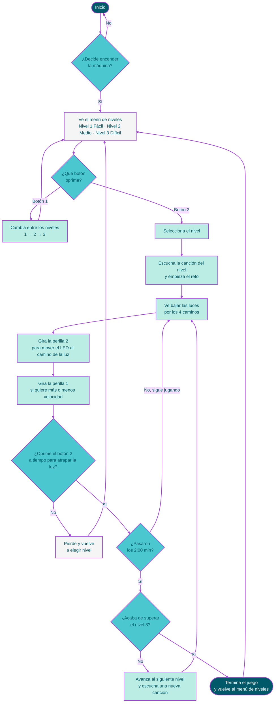
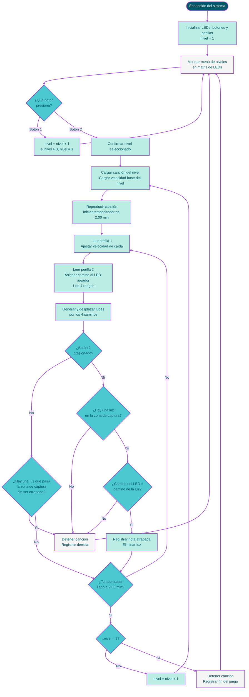
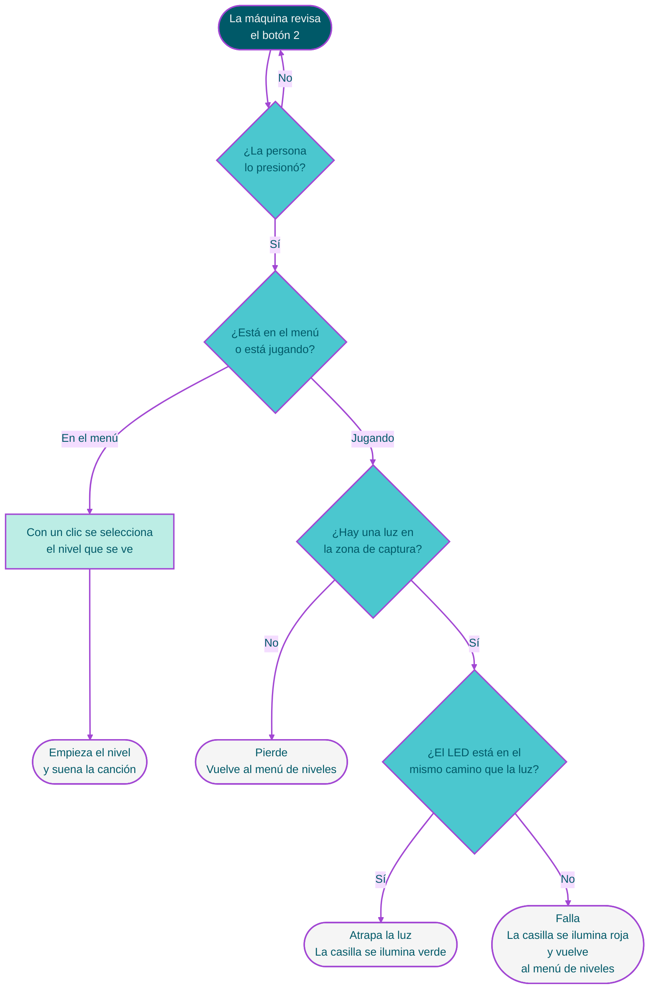

**Realizado por:**  
*Francisca Jesús Palma Cuevas (frannciscapalma)*
&nbsp;&nbsp;&nbsp;&nbsp;&nbsp;&nbsp;&nbsp;&nbsp;&nbsp;&nbsp;&nbsp;&nbsp;&nbsp;&nbsp;&nbsp;&nbsp;
*Nicolás Elías Valdés Greve (nicolasvaldesgreve)*&nbsp;&nbsp;&nbsp;&nbsp;&nbsp;&nbsp;&nbsp;&nbsp;&nbsp;&nbsp;&nbsp;&nbsp;&nbsp;&nbsp;&nbsp;&nbsp;
*Santiago Cifuentes Vélez (santiagocifuvelez)*&nbsp;&nbsp;&nbsp;&nbsp;&nbsp;&nbsp;&nbsp;&nbsp;&nbsp;&nbsp;&nbsp;&nbsp;&nbsp;&nbsp;&nbsp;&nbsp;
*Tomás Antonio Catrileo Curihual (tomascatri)*&nbsp;&nbsp;&nbsp;&nbsp;&nbsp;&nbsp;&nbsp;&nbsp;&nbsp;&nbsp;&nbsp;&nbsp;&nbsp;&nbsp;&nbsp;&nbsp;

 <br>

 **Entregables:**   
 - *Simulación digital en wokwi*
 - *Prototipo físico tangible de altiro hero*

**Indice:**   
- Génesis del proyecto
   - Contexto / investigación / referentes.
- Diagramas de flujo
   - Experiencia de usuario
   - Máquina (altiro hero)
   - Perillas
   - Botones
- Factura de materiales
- Pseudocódigo del rol de los componentes
   - Switch
   - Botones
   - Perillas
- Construcción tangible de Altiro hero
- Referentes

# Génesis del proyecto
<details>


## Contexto del proyecto:

<details>

Nuestro proyecto consiste en la creación de un dispositivo interactivo de entretenimiento. Elegimos como computador de referencia para el diseño de la carcasa y la interfaz, la **Game Boy Color**, principalmente por la estética de su carcasa y por la forma en que organiza sus controles.


Fue lanzada en 1998 como sucesora de la Game Boy original y trajo una mejora gráfica al poder mostrar juegos en color, algo revolucionario en su momento para las consolas portátiles. Una de las versiones más llamativas que sacaron fue el modelo transparente, permitiendo a los usuarios ver los componentes internos, lo cual era una tendencia estética muy querida a finales de los años 90.

Para definir la dinámica del juego, nos inpiramos en **Guitar Hero** y **DJ Hero**.


Del primero, tomamos su mecánica, en la que el jugador debe presionar el botón correspondiente en el momento justo, siguiendo el ritmo de la canción. Esto nos interesó porque convierte la coordinación entre una secuencia visual y una acción física en el centro de la experiencia. Del segundo rescatamos el movimiento que tiene el jugador a lo largo de la interfaz, deslizandose para coincidir con el patrón del juego.

Es así como nace **Altiro Hero**, una máquina de entretenimiento compuesta por dos botones y dos perillas, en la que el jugador debe seguir un patrón de luces al ritmo de la música.

El dispositivo se enciende con un interruptor ubicado en la parte inferior del costado derecho de la máquina. Su pantalla es una matriz de 8x8 LEDs, que dividimos en cuatro columnas de dos LEDs de ancho cada una. Por estas columnas descienden los rectángulos de luz que conforman el patrón del juego. Bajo la matriz, a la izquierda, se encuentra una perilla, y a la derecha, un botón. Con la perilla, el jugador se desplaza horizontalmente para elegir la columna en la que se posicionará, y con el botón responde al patrón en el momento en que el rectángulo llega a la fila delimitada para el jugador de 1 LED de altura y 8 de ancho que está en la parte inferior de la matriz. Si acierta, la casilla se ilumina de verde; si falla, de rojo. 

El juego cuenta con tres niveles, que se eligen desde el menú con el segundo botón, ubicado en el costado derecho: una pulsación avanza entre nivel 1, 2 y 3, y para seleccionar el nivel deseado se presiona el botón que está debajo de la matriz LED cuando el número del nivel se muestre en la pantalla. Debajo del botón que se encuentra al costado derecho hay una segunda perilla que permite aumentar o disminuir la velocidad de descenso del patrón, lo que ajusta la dificultad a tu gusto. Cada nivel dura un máximo de dos minutos y al superarlo sin cometer ningún error, comienza el siguiente de manera automática, mientras que si cometes un error vuelves al menú de selección de niveles. Una vez completados los tres niveles, el dispositivo regresa al menú inicial.

</details>
</details>

# Diagramas de flujo 
<details> 
 
## Mapa de flujo Experiencia de usuario

<details> 


</details>

## Mapa de flujo Máquina

<details> 


</details>

## Diagrama de flujo, botones 

<details> 
 
 Botón 1:
 ```mermaid
%%{init: {'theme':'base','themeVariables':{'fontFamily':'Arial','lineColor':'#A247D3','primaryTextColor':'#005968'}}}%%
flowchart TD
    A([La máquina revisa<br/>el botón 1]) --> B{"¿La persona<br/>lo presionó?"}
    B -- No --> A
    B -- Sí --> C["Se registra una pulsación<br/>(mantenerlo apretado<br/>no cuenta más veces)"]
    C --> D["El nivel cambia<br/>1 → 2 → 3 → 1"]
    D --> E["La matriz de LEDs<br/>muestra el nuevo nivel"]
    E --> A

    classDef inicio fill:#005968,stroke:#A247D3,stroke-width:2px,color:#F5F5F5;
    classDef decision fill:#4BC7CF,stroke:#A247D3,stroke-width:2px,color:#005968;
    classDef proceso fill:#BCEDE5,stroke:#A247D3,stroke-width:2px,color:#005968;
    classDef aviso fill:#F5F5F5,stroke:#A247D3,stroke-width:2px,color:#005968;

    class A inicio;
    class B decision;
    class C,D proceso;
    class E aviso;

    linkStyle default stroke:#A247D3,stroke-width:2px;
```
 
</details>

<details> 

Botón 2 

 
</details>

## Diagrama de flujo, perillas 

<details> 
 holi
</details>
</details>

# Factura de materiales:

<details> 

Nuestro proyecto será un juego de ritmo el cual tendrá los siguientes componentes:

| Componentes | Cantidad | Precio unitario | Link |
| --- | --- | --- | --- |
| Raspberry Pi Pico 2W | 1 | $14.990 | <https://raspberrypi.cl/products/raspberry-pi-pico-2-w-con-headers> |
| Matriz LED RGB 8×8 con WS2812B | 1 | $9.990 | <https://afel.cl/products/matriz-led-rgb-88-con-ws2812b-64-pixeles-direccionables> |
| Parlante 36mm 8Ω | 1 | $2.290 | <https://pinout.cl/producto/parlante-mini-redondo-de-8-ohm> |
| Botón pulsador | 2 | $100 | <https://afel.cl/products/boton-tactil-tapa-12x12x7-3-interruptor> |
| Potenciómetro b100k | 2 | $495 | <https://altronics.cl/potenciometro-lineal-100k-b100k> |
| Palanca switch | 1 | $400 | <https://afel.cl/products/interruptor-mts-102-3-pines> |

---

</details>

# Pseudocódigo del rol de los componentes:

<details>
 
## Switch

```cpp
Switch publico

int patita
bool bascular // aprendimos palabra nueva

switch enciende
switch apaga // (?)
```

- Switch: Encendido y apagado del juego
    - Para apagar la pantalla, posición 0
    - Para encender la pantalla, posición 1
    

## Botones

```cpp
Botón publico (todo público, no olvidar)

bool presionado
int duracionPresionado
int patita

Boton lee
Boton presiona
Boton suelta
```

- Botón 1: Cambio de nivel del juego (nivel 1, 2 y 3)
    - Tres estados posibles: presión 1, presión 2, presión 3. con presion 4 volver a estado 1.
    - En presión 1, selección de nivel de dificutlad 1
    - En presión 2, selección de nivel de dificultad 2
    - En presión 3, selección de nivel de dificultad 3

- Botón 2: Selección del LED posicionado
    - Al presionar el botón en la casilla correcta, se pone el LED en verde
    - Al presionar el botón en la casilla incorrecta, se pone el LED en rojo

## Perillas

```cpp
Perilla pública

int patita
int posicion

void leer
```
    
- Perilla 1: Cambio de velocidad del nivel
    - Resolución de la perilla en raspi es de 0-4095, se usará este espectro para controlar la velocidad en la que caen los rectángulos que debes atrapar en la fila inferior de la pantalla. 0 es la velocidad más lenta mientras que 4095 es la más rápida.
    
- Perilla 2: Recorrido de la posición del led 
    - Resolución de la perilla en raspi es de 0-4095, se delimitará cuatro posiciones posibles para poder moverte con este dentro de la pantalla.
        - Posición 1, rectángulo en extremo inferior derecho
        - Posición 2, rectángulo en mitad derecha inferior
        - Posición 3, rectángulo en mitad izquierda inferior
        - Posición 4, rectángulo en extremo inferior izquierdo.

 </details>

# Construcción tangible de Altiro hero

<details>

Paleta de colores: Colours Cafe
 


 
---
</details>

# Pseudo no tan pseudos (? son reales pero idk

```cpp
// perillas:)

// esto es Perilla.h
class Perilla {

  public:

  int patita;              // atributos 
  int posicion = 0

  Perilla (int nuevaPatita);    // esto es constructor

  void leer();    // estos son metodos

  };

  #endif

 // ---- hola ------ separo h de cpp ------ hola(?)
      
 // esto es Perila.cpp

  #include "Perilla.h"

  Perilla::Perilla (int nuevaPatita) {

    Perilla::patita = nuevaPatita;

    adc_init();
    adc_gpio_init(Perilla::patita);
  }

  void Perilla::leer() {

    adc_select_input(Perilla::patita - pinPerilla) // en pinPerilla 
                                                  // poner el pin en donde está el pote
    Perilla::posicion = adc_read();
  }

 // ----- hola lo de abajo es santi creo para explicar qué hacen nuestros botones al grupo que se encargará de nuestra clase Boton

// ============================================================
// BOTÓN 1: moverse por los niveles y elegir uno
// (solo se usa en el menú de niveles, la acción de navegar
// y seleccionar el nivel con el que la persona va a jugar)
// ============================================================
// Este botón va a tener estados:
// noPresionado
// estaSiendoPresionado
// soltado
//
// **Atributos**
//
// Qué necesita saber este botón:
//  - En qué pin está conectado de la raspberry.
//  - Si en este momento está presionado o noPresionado.
//  - Soltado.
//  - Cuánto tiempo esperar para decidir si fue una o dos pulsaciones:
//    0,6 segundos desde la primera pulsación.
//    (Debe quedar como una constante fácil de cambiar en el .h,
//    por si al probar con personas reales hay que ajustarla.)
//  - Cuántas veces lo han presionado en este intento (0, 1 o 2).
//  - Cuándo fue la última vez que lo presionaron.

// Qué hace:
//  Cuando la persona presiona el botón por primera vez, el botón pasa
//  de noPresionado a estaSiendoPresionado. Cuando ella lo suelta,
//  pasa a soltado, cuenta UNA pulsación, anota la hora y vuelve
//  a noPresionado. En ese momento el botón todavía no avisa nada:
//  empieza a esperar 0,6 segundos para ver si viene una segunda
//  pulsación.
//
//  Si dentro de esos 0,6 segundos la persona lo presiona otra vez
//  (y lo suelta), el botón avisa: "fueron DOS pulsaciones". Eso
//  significa que ella quiere SELECCIONAR el nivel en el que está.
//
//  Si pasan los 0,6 segundos y no hubo segunda pulsación, el botón
//  avisa: "fue UNA pulsación". Eso significa que ella quiere
//  CAMBIAR al siguiente nivel.
//
//  Para que cuente una nueva pulsación, el botón primero debe soltarse
//  y volver a ser presionado. Si la persona lo deja presionado, cuenta
//  como una sola pulsación y no se repite sola.
//
//  Después de avisar, el botón se reinicia y queda listo para empezar
//  de nuevo. Si la persona presiona tres veces o más, se cuentan solo
//  las dos primeras y lo demás se ignora.

// Cómo debe reaccionar el programa principal:
//  - Si el aviso es UNA pulsación: pasar al siguiente nivel
//    (del 1 al 2, del 2 al 3, y del 3 vuelve al 1).
//  - Si el aviso es DOS pulsaciones: confirmar el nivel y empezar el juego.
//  - Mientras se juega, este botón no se consulta, no hace nada.
//
// Nota importante:
//  Como la máquina espera 0,6 segundos para estar segura de que no viene
//  una segunda pulsación, el cambio de nivel tarda ese tiempo en notarse.
//  Para que la persona no sienta que el botón "no responde", hacer 
//  que esta acción de un feedback inmediata al primer clic
//  por medio de un parpadeo corto de una LED o un sonido, aunque el
//  cambio de nivel se confirme después.


// ============================================================
// BOTÓN 2: atrapar la luz
// (solo se usa durante el juego, la acción de jugar y atrapar
// la luz del LED)
// ============================================================
// Este botón va a tener estados:
// noPresionado
// estaSiendoPresionado
// soltado
//
// **Atributos**
//
// Qué necesita saber este botón:
//  - En qué pin está conectado de la raspberry.
//  - Si en este momento está presionado o noPresionado.
//  - Soltado.
//  No tiene límite de tiempo ni tiempo de descanso, a propósito.

// Qué hace:
//  Cada vez que la persona presiona el botón, el botón avisa de
//  inmediato: "intentó atrapar". Sin esperas y sin límite de
//  pulsaciones por segundo.
//
//  Esto es importante porque en los niveles rápidos, o cuando la persona
//  sube la velocidad con la perilla 1, las luces bajan muy rápido
//  y ella necesita presionar muy rápido también.
//  El botón tiene que poder seguirle el ritmo.
//
//  Para que cuente una nueva pulsación, el botón primero debe soltarse
//  y volver a ser presionado. Si la persona lo deja presionado, cuenta
//  como un solo intento y no se repite solo.
//  No importa cuánto tiempo lo mantenga presionado: el botón no se
//  bloquea ni da error por eso.

// Cómo debe reaccionar el programa principal:
//  El botón NO decide si la luz fue atrapada. Solo avisa que la persona
//  presionó. Quien decide es el programa principal, y revisa dos cosas:
//    1. ¿Había una luz en la zona de captura?
//    2. ¿El LED de la jugadora estaba en el mismo camino que esa luz?
//       (El LED siempre está en uno de los 4 caminos, según
//       dónde esté la perilla 2.)
//
//  Si las dos respuestas son sí, la luz se atrapa y el juego sigue.
//  Si alguna respuesta es no, la jugadora pierde y regresa
//  al menú de niveles.
//
//  Durante el menú de niveles, este botón no hace nada.
```

---

# Referentes

<details>

+ <https://youtu.be/n0YoaTSh_bI>
+ <https://es.wikipedia.org/wiki/Game_Boy_Color>
+
+

</details>
