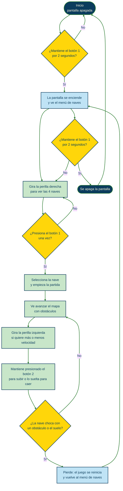
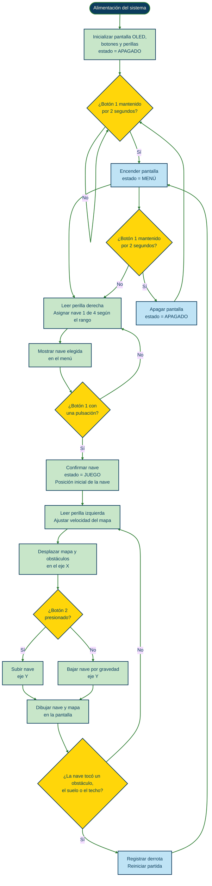
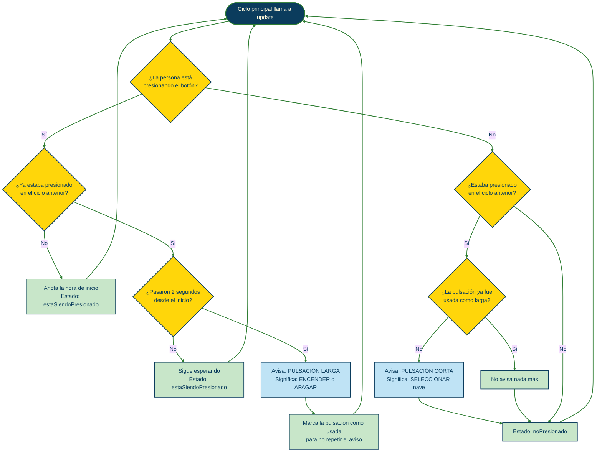
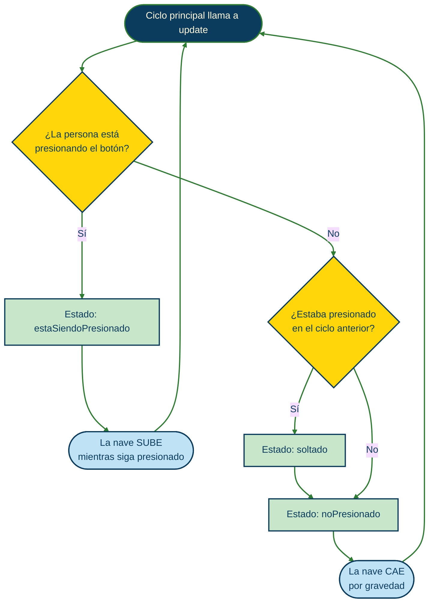
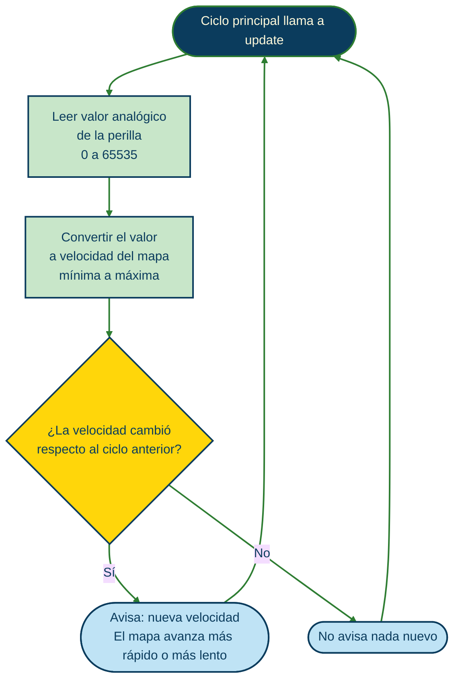
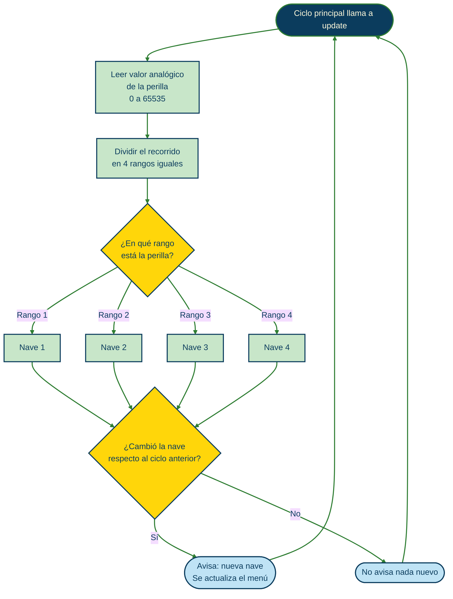

# Proyecto 2 

**Integrantes:**


- Belén Castillo / [bombobby](https://github.com/bombobby) 


- Martina Fernandez / [pumpkinguurl](https://github.com/pumpkinguurl) 

- Maite Villarroel / [maiteev](https://github.com/maiteev) 


- Nacha Zamudio / [nachazamudio](https://github.com/nachazamudio)


# Space Float 
Space Float es un juego de nave, la cual hay que mantener volando por el mayor tiempo que pueda sin chocar con obstáculos ni caer al suelo. Tendrá 2 botones y 2 perillas para su uso, el primer botón es seleccionador, al mantenerse presionado durante 2 segundos, prende y apaga el juego, el segundo botón volador es el que sirve para mantener la nave volando, ya que al presionarlo la nave sube hasta que el botón se suelta y la nave comienza a caer, por lo que se debe intercalar el presionar y soltar para evitar que la nave caiga. Las perillas manejan dos aspectos distintos, la perilla derecha es una selección de diferentes naves para que el usuario escoja, son cuatro naves: 1-calabaza, 2-chango, 3-gato alien y 4-vaca . La perilla izquierda  regula la velocidad de juego, pudiendo subir o bajar la dificultad para ajustarla a sus capacidades. 

| Control | Acción |
|---|---|
| **Botón 1 (seleccionador)**, mantenido 2 segundos | Enciende o apaga la pantalla |
| **Botón 1 (seleccionador)**, una pulsación | Confirma la nave elegida y comienza la partida |
| **Botón 2 (volador)**, mantenido | La nave sube (eje Y) |
| **Botón 2 (volador)**, soltado | La nave cae (eje Y) |
| **Perilla izquierda** | Aumenta o disminuye la velocidad del mapa (eje X) |
| **Perilla derecha** | Cambia la nave seleccionada en el menú |

Esta idea de proyecto esta totalmente inspirado en el juego Flappy Bird 


# Computador elegido 
**Apple iMac G3 (1998)** 


Lanzado el 6 de mayo de 1998, el iMac G3 cambio la forma de vender a  Apple, arrancando una nueva era de productos icónicos, como el iPod, iPhone y iPad. Era super reconocible por su diseño de plástico transparente en colores muy llamativos y su forma particular, además revolucionando siendo pionera en el mercado al deshacerse del disquete para irse por los puertos USB y el CD.

**Interfaz de usuario:**

Este computador cambió por completo la forma de comprar de los usuarios. Antes de la llegada del iMac, la tecnología siempre manejó la misma estética: equipos sobrios, grises y rectangulares. Cuando Apple presentó el iMac, transformó la forma de vender en un momento clave, justo cuando muchísima gente compraba su primera computadora. Lanzar al mercado un equipo con variedad de colores y un diseño tan particular rompió con la frialdad de la industria de esa época.
A partir de ahí, los compradores ya no solo elegían una máquina por su funcionamiento, sino también por una estética que reflejaba su propia identidad y que se integraba como un objeto interesante en su espacio. Todo esto demostró un éxito rotundo, pasando de ver al usuario como un simple operador de tecnología a un consumidor cautivado por el diseño, e iniciando una era donde la conexión visual y la experiencia de uso pasaron a ser factores decisivos de compra.

----

**¿Porque este computador?** 

steve jobs genio, se fue, apple a la bancarrota, vuelve, dice “no vamos a hacer lo mismo que todos”, innova, personaliza, llama la atención y pum dijo “pa los gustos los colores” y sacó los imac g3 full color escoja caserita, ¿qué hay debajo de toda esa carcasa? no se preocupe caserita aquí se lo mostramos ¿que no entiende nada? yo tampoco pero se ve de locos siono si

en palabras formales, nos llamó la atención lo innovadora de la propuesta que trajo steve jobs al regresar como CEO de apple luego de ser despedido, algo que hoy en día podemos tomar como “obvio” que es el hecho de tener un objeto personal que se ajuste más a nuestros gustos solo por el hecho de poder escoger el color haya podido causar tanto revuelo. Además, de la decisión estética de permitir que se vea el contenido electrónico del computador y de los tipos de conexiones que admitió este computador que eliminó el puerto de disquetes y el haber agregado el puerto de conexión para los cables de internet, algo que recién se venía expandiendo en la época.

a mi personalmente me gustan los mouse con formas raras, hubiese amado tener uno de esos mouse con los que probablemente me hubiese dolido la mano de una manera - pumpkinguurl

# Atributos/Metodos/Constructores 
 ```cpp
//constructor del botón
//boton1:
//botón seleccionador
//boton2: 
//botón de Movimiento

//métodos del botón
//boton1:
//puede encender
//puede apagar
//puede seleccionar
//tiempo de antirrebote 
//boton2:
//puede subir - se mueve en el eje y
// mientras no se aprieta, el personaje cae 

//atributos del botón
//boton1:
// noPresionado a estaSiendoPresionado
//está presionado por 2sg
//tiempoParaMantener (2000ms) 
//está encendido
//está apagado
//está presionado por menos de 2sg
//está seleccionando una opción

//boton2:
// noPresionado a estaSiendoPresionado
//está presionado 
//constructor de las perillas
//perilla1:
//perilla seleccionadora de 4 personajes
//número de patita, deduce a qué canal del lector analógico 
//perilla2: 
//Encargada de regular la velocidad del mapa / juego 
//Recibe el número del pin físico al que está conectada esta perilla 


//métodos de la perilla
//perilla1:
//Divide el rango total del potenciómetro entre el número de personajes. 
//calcular el tamaño que le toca a cada personaje en el giro. 
//Determina en qué "casilla" cae la lectura filtrada actual. 
//perilla2:
//Toma la lectura filtrada interna 
//Cuando la perilla está al mínimo (0.0), el mapa avanza a la velocidad mínima (por ejemplo, 20 píxeles por segundo). 
//Cuando la perilla está al máximo (1.0), el mapa avanza a la velocidad máxima (por ejemplo, 90 píxeles por segundo).
//En cualquier punto intermedio, calcula la velocidad proporcional exacta para acelerar o frenar el avance del escenario suavemente.

//atributos de la perilla
//perilla1:
//Para recordar en qué patita físicamente está conectada la perilla y qué canal del lector analógico le toca consultar. 
//Un entero que recuerde qué opción (0, 1, 2 o 3) estaba seleccionada en la última comprobación.    
//perilla2:
//Un número entero que almacena la posición física limpia de la perilla tras procesar la señal del convertidor 

 ```

# Materiales 
| Componentes | Cantidad | Precio unitario | Link |
| --- | --- | --- | --- |
| Raspberry Pi Pico 2W | 1 | $14.990 | <https://raspberrypi.cl/products/raspberry-pi-pico-2-w-con-headers> |
| Pantalla OLED 128×64 I2C  | 1 | $4.275| <https://afel.cl/products/pantalla-lcd-oled-azul-y-amarillo-0-96?pr_prod_strat=similar&pr_rec_id=22da38dac&pr_rec_pid=8381957570712&pr_ref_pid=8381902258328&pr_seq=uniform> |
|Botón Táctil Tapa 12x12x7.3 - Interruptor| 2 | $100| <https://afel.cl/products/boton-tactil-tapa-12x12x7-3-interruptor?_pos=2&_sid=c1a18aabb&_ss=r>  |
|Potenciómetro precision de rotación ajustable 270° | 2 |$350 | <https://zamper.cl/cl/products/potenciometro-precision-de-rotacion-ajustable-270-1855?srsltid=AYCX9vJ52P0V7IY7rqd_A2PkXN33k9fyvnsHMGatWmAEVxbguBIJ7VkvvuQ>|

 
Avances proyecto: [avances](./codigos)


# Mapa de flujo
# [Space Float]


Juego de nave inspirado en *Flappy Bird*, programado para una **Raspberry Pi Pico** y mostrado en una pantalla OLED de 0,96". El objetivo es mantener la nave volando el mayor tiempo posible, esquivando obstáculos.


---


## Descripción


Una nave avanza por un mapa que se desplaza de forma infinita. La persona que juega debe controlar la altura de la nave intercalando entre presionar y soltar un botón: al presionarlo la nave sube, y al soltarlo comienza a caer. Si la nave choca con un obstáculo o con el suelo, el juego se reinicia. **No hay victoria**: el juego continúa infinitamente y el desafío es durar lo más posible.


El juego cuenta con:


- **Selección de nave:** al iniciar, un menú permite elegir 1 de 4 personajes.
- **Dificultad ajustable:** una perilla regula la velocidad con que avanza el mapa.
- **Encendido y apagado** de la pantalla desde un botón.


---


### Conexiones


> Completar con los pines definitivos del proyecto.


| Componente | Pin de la Pico |
|---|---|
| Botón 1 (seleccionador) | `GP__` |
| Botón 2 (volador) | `GP__` |
| Perilla izquierda (velocidad) | `GP26 (ADC0)` |
| Perilla derecha (selección de nave) | `GP27 (ADC1)` |
| OLED SDA | `GP__` |
| OLED SCL | `GP__` |
| OLED VCC / GND | `3V3` / `GND` |


---


### Paso a paso


1. Conecta la Raspberry Pi Pico a la corriente.
2. Mantén presionado el **botón 1** durante 2 segundos para encender la pantalla.
3. Gira la **perilla derecha** para ver las 4 naves disponibles.
4. Presiona **una vez el botón 1** para elegir tu nave.
5. Ajusta la dificultad con la **perilla izquierda**.
6. Presiona y suelta el **botón 2** de forma alternada para mantener la nave en el aire y esquivar obstáculos.
7. Si chocas, el juego se reinicia y vuelves al menú de selección.


---## Diagramas de flujo


<details>
<summary><b>Mapa de flujo: experiencia de usuario</b></summary>





</details>


<details>
<summary><b>Mapa de flujo: máquina</b></summary>





</details>


<details>
<summary><b>Diagrama de flujo: botones</b></summary>


**Botón 1 (seleccionador):** pulsación corta selecciona, pulsación larga (2 segundos) enciende o apaga.





**Botón 2 (volador):** mientras se mantiene presionado la nave sube; al soltarlo, cae.





</details>


<details>
<summary><b>Diagrama de flujo: perillas</b></summary>


**Perilla izquierda (velocidad del mapa):**





**Perilla derecha (selección de nave):**





</details>

