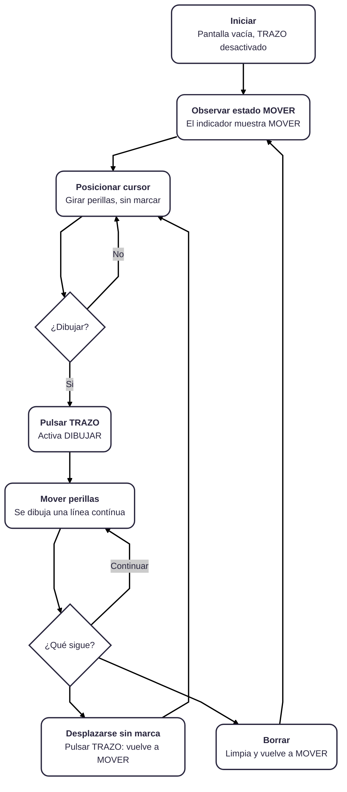
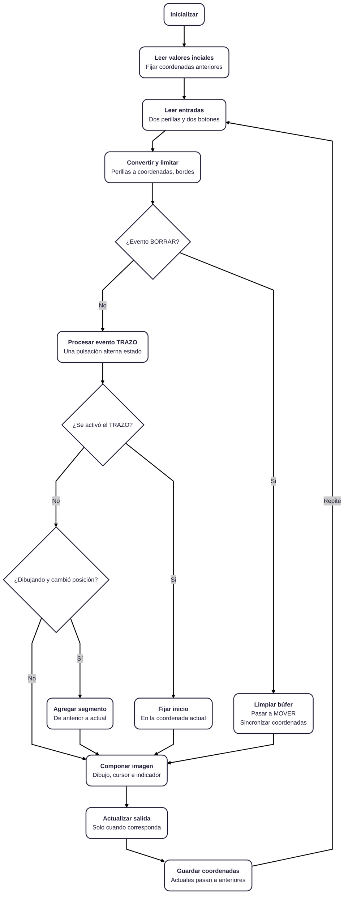

# proyecto-02

## TRAZO

### Integrantes

- Isidora Díaz [@isiidoraadiiaz](https://github.com/isiidoraadiiaz)
- Natalia Gutierrez [@blosssom-n](https://github.com/blosssom-n)
- Carlo Martínez [@zaaaiko](https://github.com/zaaaiko)
- Natalia Pilar [@sz-mada](https://github.com/sz-mada)

## Descripción del proyecto

### 01. ¿Qué es TRAZO?

TRAZO es un proyecto de dibujo digital que funciona a través de dos perillas. La idea es que podamos crear dibujos en una pantalla, pero en vez de utilizar un mouse o un lápiz digital, los trazos se van formando a partir del movimiento de estos controles.

Para hacerlo utilizamos dos potenciómetros, una Raspberry Pi Pico y una pantalla. Cada potenciómetro controla un eje diferente: uno mueve el cursor de forma horizontal (X) y el otro de forma vertical (Y).

Al girar las perillas podemos ir cambiando la posición del cursor y, al activar el dibujo, generar líneas que siguen ese recorrido.

Además, incorporamos dos modos: MOVER, que permite desplazarnos por la pantalla sin dibujar, y DIBUJAR, que conecta las posiciones del cursor para formar los trazos. También tenemos un botón para borrar y comenzar de nuevo.

Lo que nos interesa de TRAZO es experimentar con otra manera de dibujar. Estamos acostumbradas a utilizar herramientas que siguen directamente los movimientos de nuestra mano, pero aquí tenemos que coordinar dos perillas para lograr el recorrido que queremos.

Esto hace que el proceso sea distinto, porque no se trata solamente del dibujo que aparece en pantalla, sino también de cómo llegamos a hacerlo.

### 02. ¿De dónde nace la idea?

Para comenzar con el proyecto nos pusimos a investigar distintas formas de dibujar digitalmente y cómo los dispositivos pueden interpretar movimientos físicos para transformarlos en imágenes.

Dentro de esta búsqueda encontramos MacPaint, un programa de dibujo que Apple lanzó en 1984 junto con el primer Macintosh.

Nos llamó la atención porque, aunque actualmente estamos muy acostumbradas a dibujar en computadores, en ese momento poder hacerlo directamente con un mouse era algo bastante novedoso.

Nos interesó especialmente entender cómo funcionaba: la persona movía el mouse y ese movimiento podía convertirse en una línea dentro de la pantalla.

A partir de eso comenzamos a pensar cómo podríamos hacer algo parecido, pero cambiando la forma de interactuar con el dispositivo.

En lugar de utilizar un mouse, quisimos probar qué pasaría si el dibujo dependiera de dos movimientos de rotación.

Así llegamos a los potenciómetros, que nos permitían controlar dos coordenadas distintas y utilizarlas para generar trazos en una pantalla.

De esta manera comenzamos a desarrollar TRAZO, tomando como referencia la relación entre el movimiento físico y el dibujo digital, pero explorándola a través de controles diferentes.

### 03. Nuestro referente: MacPaint (1984)

MacPaint fue un programa de dibujo digital desarrollado por Bill Atkinson y lanzado por Apple en enero de 1984, junto con el primer computador Macintosh.

En esa época los computadores no funcionaban de la misma manera en que los conocemos hoy. Muchas interacciones todavía dependían de escribir comandos, por lo que comenzar a utilizar interfaces gráficas y dispositivos como el mouse permitió que las personas interactuaran con ellos de una manera mucho más visual.

MacPaint fue uno de los programas que ayudó a mostrar estas posibilidades, permitiendo dibujar directamente sobre una pantalla.

Tenía herramientas como lápices, pinceles, borradores, figuras geométricas y diferentes patrones en blanco y negro.

Aunque ahora parecen herramientas bastante básicas, nos pareció interesante pensar que muchas de las funciones que utilizamos actualmente en programas de dibujo ya estaban presentes en MacPaint.

Lo importante era que no necesitabas saber programar para generar una imagen. Podías seleccionar una herramienta, mover el mouse y comenzar a dibujar.

#### 03.1. ¿Cómo nació MacPaint?

MacPaint fue desarrollado por Bill Atkinson, quien ya había trabajado en sistemas gráficos para los computadores de Apple.

Antes de MacPaint, Atkinson había participado en el desarrollo de herramientas gráficas para Lisa, otro computador de la empresa.

En febrero de 1983 comenzó a trabajar en MacPaint para el Macintosh.

Algo que nos pareció interesante es que su desarrollo no estuvo enfocado solamente en tener muchas herramientas, sino en que el programa fuera sencillo y entretenido de utilizar.

Según los relatos de Andy Hertzfeld, integrante del equipo original del Macintosh, Atkinson prefería desarrollar una aplicación intuitiva que permitiera dibujar libremente, en lugar de una herramienta demasiado compleja.

El programa estuvo terminado en octubre de 1983 y llegó al público en enero de 1984.

Nos parece interesante este proceso porque muestra cómo, a partir de explorar nuevas tecnologías, pueden aparecer formas diferentes de hacer actividades que ya conocíamos, como dibujar.

### 04. ¿Cómo funcionaba MacPaint?

MacPaint trabajaba con un sistema llamado *bitmap*, donde las imágenes estaban formadas por pequeños puntos llamados píxeles.

En el Macintosh original estos píxeles se representaban en blanco y negro.

El funcionamiento era bastante sencillo de entender. Al mover el mouse, el computador registraba ese movimiento y actualizaba la posición del cursor en pantalla.

Si la persona seleccionaba la herramienta de lápiz y mantenía presionado el botón del mouse mientras lo movía, el programa transformaba ese recorrido en una línea.

Esto ocurría a través de cuatro etapas:

1. **Movimiento:** la persona desplazaba el mouse.
2. **Lectura:** el computador recibía la información del movimiento y los botones.
3. **Procesamiento:** el programa interpretaba esos datos según la herramienta seleccionada.
4. **Resultado:** el dibujo aparecía en la pantalla.

También utilizaba QuickDraw, un sistema gráfico desarrollado por Atkinson que permitía representar elementos visuales en la pantalla del Macintosh.

Lo que nos pareció más interesante de todo esto fue entender que el dibujo digital funciona a partir de información que el computador interpreta.

En otras palabras, el mouse no está dibujando directamente sobre la pantalla, sino que el programa recibe datos, los procesa y genera una representación visual.

Esa fue una de las ideas que más nos sirvió para empezar a pensar TRAZO.

### 05. ¿Qué rescatamos de MacPaint?

Después de investigar su funcionamiento, identificamos algunas características que queríamos rescatar para nuestro proyecto.

#### El movimiento convertido en dibujo

Lo que más nos interesó fue cómo una acción física podía transformarse en una línea digital.

En MacPaint esto sucedía al mover el mouse. En TRAZO quisimos probar el mismo principio, pero utilizando el giro de potenciómetros.

#### La simpleza de los controles

Otra cosa que nos gustó fue que MacPaint permitía dibujar sin necesitar demasiados conocimientos técnicos.

Nosotras también queríamos que TRAZO se entendiera desde la interacción, que una persona pudiera probar las perillas y comenzar a descubrir cómo controlar el dibujo.

#### Poder experimentar libremente

MacPaint no estaba pensado para producir un único tipo de imagen. Permitía probar herramientas, crear formas, equivocarse, borrar y volver a empezar.

En TRAZO también queremos mantener esa posibilidad de experimentar y construir dibujos a partir de los movimientos que vamos realizando.

#### La respuesta inmediata

Nos interesó especialmente que el resultado visual apareciera mientras la persona interactuaba con el dispositivo.

Por eso, en TRAZO buscamos que el movimiento de las perillas se refleje en la posición del cursor y que podamos observar cómo se construyen los trazos.

### 06. ¿Cómo llevamos esto a TRAZO?

Una vez que entendimos el funcionamiento de MacPaint, comenzamos a investigar cómo podíamos aplicar ese principio utilizando los componentes electrónicos del proyecto.

Decidimos trabajar con dos potenciómetros porque nos permitían controlar dos valores de manera independiente.

Un potenciómetro funciona como una resistencia variable. Cuando giramos la perilla, cambia el voltaje de su señal de salida.

La Raspberry Pi Pico puede leer esos cambios y transformarlos en valores digitales.

A partir de estos valores podemos calcular una posición dentro de la pantalla.

Por ejemplo, cuando giramos el primer potenciómetro cambia la coordenada X y el punto se mueve hacia la izquierda o derecha.

Cuando giramos el segundo cambia la coordenada Y, moviendo el punto hacia arriba o abajo.

Al combinar los dos movimientos podemos recorrer diferentes posiciones de la pantalla.

Después, utilizando las funciones gráficas del código, podemos conectar esos puntos para generar líneas.

Lo interesante es que, a diferencia de MacPaint, no estamos moviendo un mouse libremente sobre una superficie, sino que tenemos que coordinar el giro de dos perillas.

Esto cambia la manera de dibujar y también los tipos de recorridos que podemos hacer.

## Proceso

### 07. Componentes que estamos utilizando

Para desarrollar el funcionamiento de TRAZO estamos trabajando con distintos componentes que cumplen funciones específicas dentro del dispositivo.

#### Raspberry Pi Pico

Es la encargada de recibir la información de los potenciómetros y botones, procesarla mediante el código y controlar lo que aparece en pantalla.

#### Dos potenciómetros

Son nuestros controles principales. Cada uno modifica una coordenada y nos permite mover el cursor dentro de la pantalla.

#### Pantalla

Es donde podemos ver la posición del cursor y los dibujos que vamos creando.

#### Botón de trazo

Nos permite cambiar entre los modos MOVER y DIBUJAR sin tener que detener el programa.

#### Botón de borrado

Sirve para limpiar la pantalla y empezar un nuevo dibujo.

### 08. Bibliotecas de programación

Una de las cosas que investigamos durante el desarrollo del código fue el uso de bibliotecas.

Las bibliotecas son conjuntos de funciones que otras personas ya han desarrollado y que podemos incorporar a nuestros proyectos.

Esto nos sirve porque no tenemos que programar absolutamente todo desde cero, especialmente cuando trabajamos con componentes como las pantallas.

Por ejemplo, las bibliotecas gráficas pueden incluir funciones para dibujar puntos, líneas y figuras, además de facilitar la comunicación entre la pantalla y el microcontrolador.

Nos interesó trabajar de esta manera porque podemos aprovechar herramientas que ya existen y adaptarlas a lo que necesitamos para TRAZO.

Además, comenzamos a familiarizarnos con el uso de bibliotecas disponibles gratuitamente, como las desarrolladas por Adafruit, y con repositorios de código que permiten investigar cómo funcionan distintos componentes.

#### Bibliotecas del código final

En este apartado debemos incorporar los nombres exactos de las bibliotecas que quedaron en nuestra versión final, explicar brevemente para qué utilizamos cada una y añadir sus enlaces de documentación.

También queremos dejar registro de las primeras opciones que investigamos, para mostrar cómo fuimos eligiendo las herramientas que necesitábamos.

### 09. Primeros códigos y pruebas

Antes de llegar al código final de esta etapa, comenzamos probando cómo podíamos hacer funcionar los componentes y relacionarlos entre sí.

Al principio necesitábamos entender cómo obtener información de los potenciómetros.

La idea era comprobar que, al girar una perilla, pudiéramos obtener un valor que cambiara según su posición.

Después comenzamos a trabajar con esos valores para convertirlos en coordenadas y utilizarlos dentro de una pantalla.

Una vez que teníamos esa lógica, el siguiente paso fue pensar cómo generar trazos en lugar de mostrar solamente un punto.

Para eso necesitábamos guardar la posición anterior y conectarla con la nueva posición.

También nos dimos cuenta de que era importante poder mover el cursor sin dibujar todo el tiempo.

Por eso comenzamos a organizar el funcionamiento en dos estados distintos: MOVER y DIBUJAR.

Otra función que incorporamos fue la posibilidad de borrar, para que se pudieran crear nuevos dibujos sin reiniciar manualmente el dispositivo.

Así fuimos pasando de pruebas individuales a un código que reúne las distintas funciones que necesitamos para TRAZO.

#### Registro de las primeras versiones

Aquí incorporaremos los códigos iniciales conservados en el documento, acompañados de una explicación de qué estábamos intentando hacer con cada uno y qué cambios realizamos después.

### 10. Código final de esta etapa

Actualmente ya tenemos una versión final del código para este avance del proyecto.

Lo que hicimos fue organizar las funciones para que el programa pudiera leer los controles, procesar los valores y decidir si tiene que mover el cursor, dibujar una línea o borrar la pantalla.

#### 10.1. Leer las perillas y los botones

Primero, el programa revisa los valores de los dos potenciómetros y el estado de los botones.

Esto se repite continuamente para que pueda responder a los movimientos que vamos haciendo.

#### 10.2. Calcular la posición

Después utilizamos los valores de los potenciómetros para calcular las coordenadas X e Y.

Como los valores originales no corresponden directamente al tamaño de la pantalla, tenemos que adaptarlos.

Para esto el código contempla tres operaciones:

- **Mapear:** convertir los valores de los potenciómetros en coordenadas de la pantalla.
- **Limitar:** evitar que el cursor se salga del espacio disponible.
- **Filtrar ruido:** reducir pequeñas variaciones de las señales que podrían generar movimientos involuntarios.

#### 10.3. Modo MOVER

Cuando iniciamos el programa, el dispositivo se encuentra en modo MOVER.

Esto significa que podemos girar las perillas y cambiar la posición del cursor sin dejar una línea.

Nos sirve para elegir desde dónde queremos empezar a dibujar.

#### 10.4. Modo DIBUJAR

Cuando presionamos el botón de trazo, el programa cambia de estado.

Si activamos DIBUJAR, comienza a conectar las posiciones del cursor y se forman las líneas.

Algo importante es que, al activar este modo, el programa debe tomar la posición actual como punto de inicio. Así evitamos que aparezca una línea desde una posición anterior.

Si volvemos a presionar el botón, regresamos al modo MOVER.

#### 10.5. Botón BORRAR

También incorporamos una función que permite limpiar el dibujo.

Cuando presionamos el botón de borrado, el programa limpia la pantalla y vuelve al modo MOVER.

Esto permite comenzar una nueva composición sin tener que reiniciar todo el sistema.

## Diagramas de flujo

### 11. Diagrama de flujo del código

Para entender mejor cómo estaba funcionando nuestro código, también hicimos un diagrama de flujo.

Nos sirvió para ordenar todas las acciones que tiene que realizar el programa y ver qué sucede cuando presionamos cada botón.

Primero se inicia el dispositivo, dejando la pantalla vacía y el modo MOVER activado.

Después comienza a leer las perillas y botones.

Si presionamos BORRAR, limpia la pantalla.

Si presionamos TRAZO, cambia entre los dos modos.

Luego calcula las coordenadas de las perillas y revisa si corresponde dibujar una línea o solamente actualizar la posición del cursor.

Una vez completado el proceso, vuelve a leer los controles para seguir respondiendo a los movimientos.

#### Diagrama de flujo del usuario

#### Diagrama de flujo del programa

Este diagrama nos ayuda a visualizar la estructura del código sin tener que revisar todas las instrucciones.

También nos permite identificar con mayor facilidad dónde se realizan las lecturas, cuándo se procesan los datos y qué condiciones determinan las acciones del dispositivo.

### 12. ¿En qué estamos ahora?

Por ahora ya tenemos definida la propuesta de TRAZO, investigamos referentes que nos ayudaron a comprender el funcionamiento del dibujo digital y desarrollamos el código correspondiente a esta etapa.

También comenzamos a trabajar con bibliotecas, exploramos las funciones de los componentes y organizamos la lógica del programa mediante un diagrama de flujo.

En esta etapa estamos enfocadas en relacionar todo lo que hemos investigado con el funcionamiento del dispositivo y en comprobar cómo responde el código al utilizar los controles.

Todavía estamos trabajando en el desarrollo de TRAZO, por lo que este registro reúne las decisiones, pruebas y avances que hemos realizado hasta el momento.

## Esquemáticos

## Referentes

## Bibliografía

### 13. Fuentes de investigación

**Computer History Museum (2010).** *MacPaint and QuickDraw Source Code.*
<https://computerhistory.org/blog/macpaint-and-quickdraw-source-code/>

**Hertzfeld, A.** *MacPaint Evolution.* Folklore.org.
<https://www.folklore.org/MacPaint_Evolution.html>

**Computer History Museum.** *Historical Source Code — MacPaint.*
<https://github.com/computerhistory/Historical-Source-Code-MacPaint-Repository>

**Apple Computer (1984).** *Using MacWrite and MacPaint.*
<https://vintageapple.org/macbooks/pdf/Using_MacWrite_and_MacPaint_1984.pdf>

**Raspberry Pi.** *Pico-series Microcontrollers Documentation.*
<https://www.raspberrypi.com/documentation/microcontrollers/pico-series.html>

## Prompts usados (chatGPT)
> **Nota:** el chat original se borró. Lo que sigue es una reconstrucción
> aproximada, hecha de memoria 

### Código 1 (25-10-2026): plan en comentarios
- **Qué pedimos (aprox):** Primero le explicamos qué es la máquina: TRAZO, un proyecto de
  dibujo digital con una Raspberry Pi Pico, dos potenciómetros (uno para el eje X y otro
  para el Y) y una pantalla OLED de 128 x 64, con modos MOVER y DIBUJAR y un botón para
  borrar. Después le pedimos que nos ayudara a hacer el primer código declarando solamente
  qué queremos que haga sin programar todavía.
- **Qué nos dio la IA:** un archivo solo con comentarios, ordenado en secciones. 

### Código 2 (26-10-2026): estructura
- **Qué pedimos (aprox.):** A partir de ese plan, la estructura mínima del programa:
  iniciar el ADC y un ciclo que muestre que el programa sigue activo, sin leer las perillas
  todavía.
- **Qué nos dio la IA:** `main.cpp` y `CMakeLists.txt` básicos.

### Código 3 y 4 (26-10-2026): perillas X/Y y corrección
- **Contexto:** ya habíamos pensado la clase Perilla y cómo se conectaría con el resto.
  Quedó pendiente integrar la clase Botón, que aun no teniamos; por eso
  estas versiones solo deberían mover un punto en la pantalla.
- **Qué pedimos (aprox.):** una clase Perilla basada en el ejemplo de la sesión 08a que
  lea los dos potenciómetros y mueva un punto en la pantalla OLED.
- **Sobre el error de la versión 3:** el error de conversión (`valor / 4095` antes de
  multiplicar) lo introdujimos **a propósito**. Queríamos entender por qué la conversión
  funciona cuando está bien hecha y qué pasaría si estuviera mal: con la división entera,
  la posición se queda en 0 salvo cuando la lectura llega al máximo. La versión 3 queda
  como ejemplo del error y la versión 4 como la corrección.
- **Corrección (versión 4):** multiplicar primero y luego dividir, con redondeo.

### Clase 1 y 2 (27 y 28-10-2026): Perilla y Encoder
- **Contexto:** al comienzo hicimos Perilla y Encoder como dos clases separadas. Al
  conversarlo con el grupo 1, que sí necesita un encoder, nos pasaron muy amorosamente <3 el enlace a un
  repositorio del profesor que muestra cómo unir ambas funciones en una sola clase.
- **Qué pedimos (aprox.):** adaptar ese ejemplo para que una sola clase Perilla sirva
  como potenciómetro y como encoder.
- **Resultado:** la versión de `clase_2` junta todo en una clase. Nosotras solo usamos la
  parte de Perilla porque no necesitamos encoder; el encoder se mantiene en el código
  porque lo usa el grupo 1.
