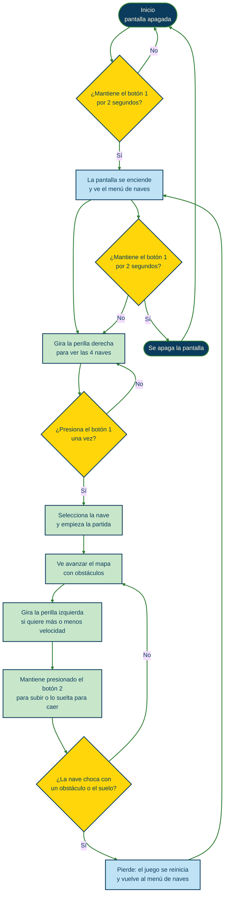
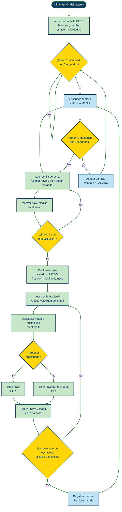
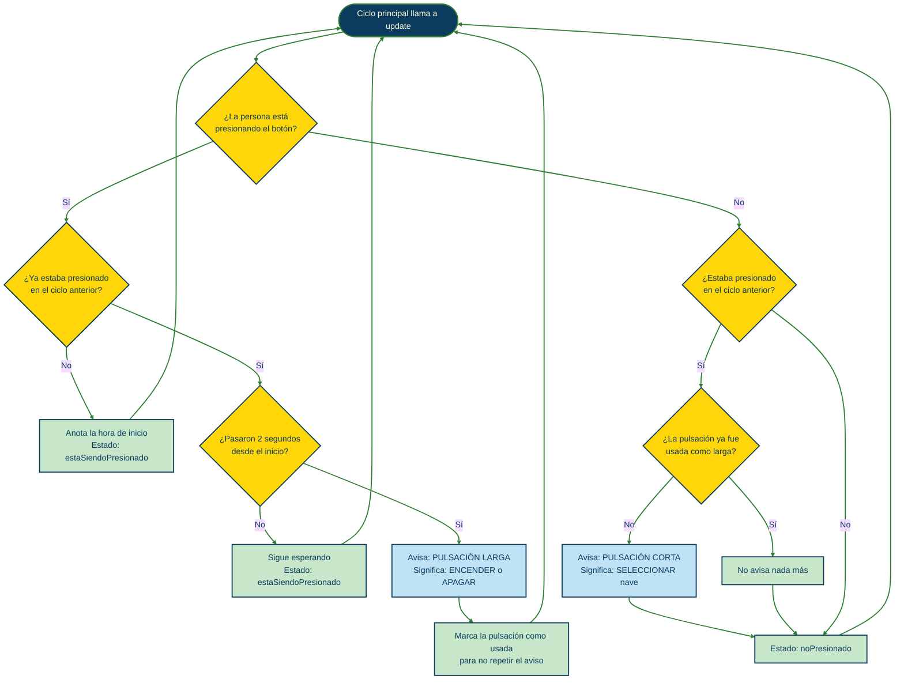
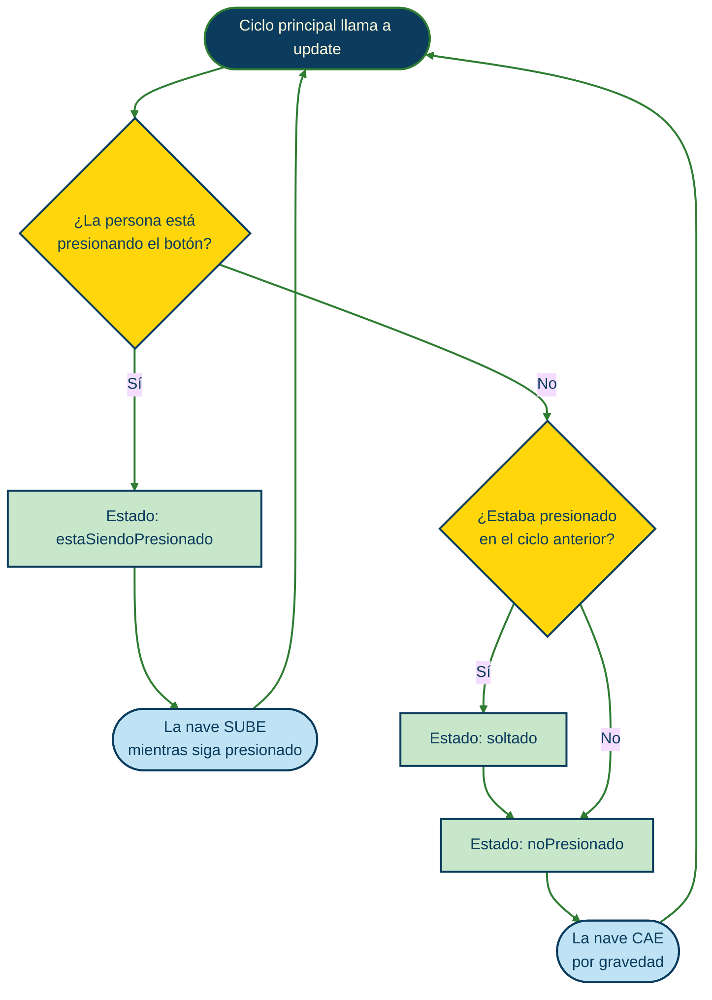
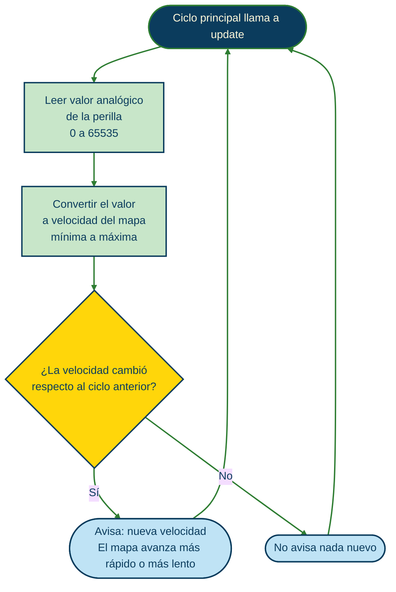
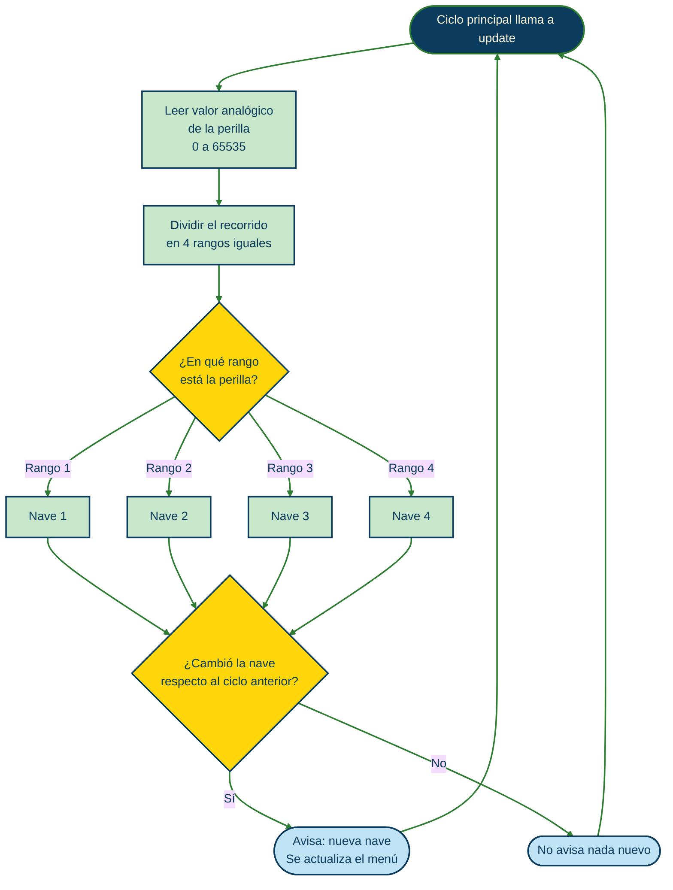

# sesion-11a

## apuntes sesión

## Diagramas de flujo

<b>Mapa de flujo: experiencia de usuario</b>

<b>Mapa de flujo: máquina</b>

<b>Diagrama de flujo: botones</b>

**Botón 1 (seleccionador):** pulsación corta selecciona, pulsación larga (2 segundos) enciende o apaga.

**Botón 2 (volador):** mientras se mantiene presionado la nave sube; al soltarlo, cae.

<b>Diagrama de flujo: perillas</b>

**Perilla izquierda (velocidad del mapa):**

**Perilla derecha (selección de nave):**

## encargos

## lectura
