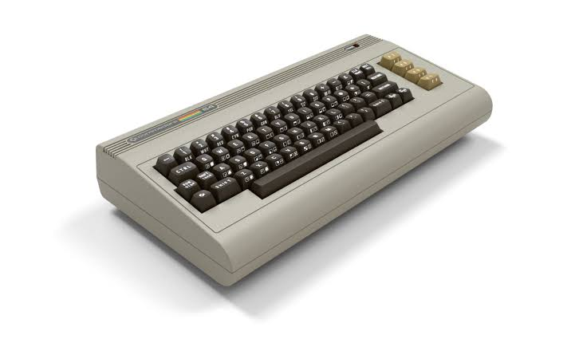
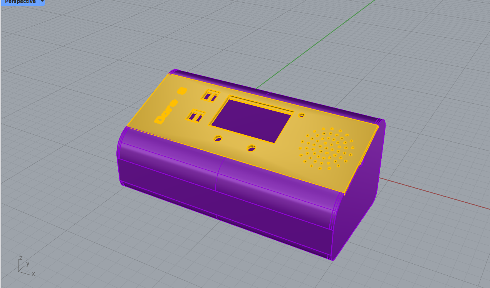

# sesion-11a

## apuntes sesión
- el día de hoy seguimos avanzando en nuestro proyecto 02, en el cual definimos mejor nuestra idea, realizando bocetos, buscando más información de nuestro computador referente, viendo carcasa y lo que queríamos lograr
## proceso proyecto-02
### commodore 64 ultimate
lo primero que realizamos fue definir de forma concreta el computador que escogeríamos como referente, en donde escogimos ```Commodore 64 ultimate```

### carcasa
luego de esto fuimos viendo carcasa, diferentes formas, ya que queríamos llegar a realizar nuestro propio commodore. en donde nos basamos de referencia principal en la forma del commodore, ya que nuestro proyecto en si es un tipo arcade, además asimilarlo a una máquina de videojuegos.



realizamos el modelado de nuestra carcasa en rhinoceros, la cual la queríamos luego imprimir en 3D



### clases
luego a la par entre Narely y Angel empezaron a realizar clases, a su vez rellenando nuestro github grupal. Luego nos quedamos después de taller para seguir evaluando nuevamente en las clase, ya que según lo que queríamos lograr en nuestro proyecto eran muchos códigos trabajando a la vez de forma simultánea

```perillas```

```botones```

```pantalla```

<https://wokwi.com/projects/479061199676387329> 

este wokwi fue el que realizamos el día de hoy, para poder realizar nuestro proyecto

## lectura
### Mindstorms: Children, Computers and Powerful Ideas - Seymour Papert
- me encuentro en el capítulo 6 llamado "Powerful Ideas in Mind-size Bites"
  
*apuntes lectura*

tipos de conocimiento

computadora como herramienta para entender el conocimiento significativo y personal

turtle microworlds -- conocer una idea tanto como se conoce una persona 

tortuga, este tipo de aprendizaje permite a los niños ser deliberados al traer un tipo de aprendizaje en el cual se sienten cómodos, familiarizándose con conceptos difíciles a su edad, para así abordarlos de una manera en la cual su tipo de estilo para aprender sea más fácil y familiar

nuevo dominio conocimiento -- nuevas ideas 

Turtles -- experiencia temprano para aprender a conocer un tema formal y sus poderosas ideas

conocimiento más cualitativo 


ordenador -- nuevo tipo actividad y relación con las ideas

poderosas ideas intuitivas y aprendizaje de forma informal, poder crear condiciones, las cuales fomenten su desarrollo

fallo en la intuición -- expectativa equivocada -- enfrentar al pensamiento intuitivo -- cómo piensa sobre los objetos 

GAL: entender los objetos como compuestos de partes o subobjetos

ARI: pensar objetos de manera más global, forma y peso

intuición -- traduce en programa, esta se vuelve intrusiva y más accesuble para la reflexión 

ideas computacionales como materiales para el trabajo de remodelación del conocimiento intuitivo

modelo de tortuga puede ayudar a cerrar la brecha entre conocimiento formal/ comprensión intuitiva

trabajar -- buscar sensibilidad del conflicto, entre las diferentes formas de pensar sobre el problema 

buena experiencia informática -- sentirse cómodo con las formas de los procedimientos 

mejor procedimiento -- comprobación errores

procedimiento -- llama, manipula, reconoce 

cómo una idea poderosa se vuelve parte del pensamiento intuitivo

pensamiento procedimental -- poderosa herramienta intelectual  


